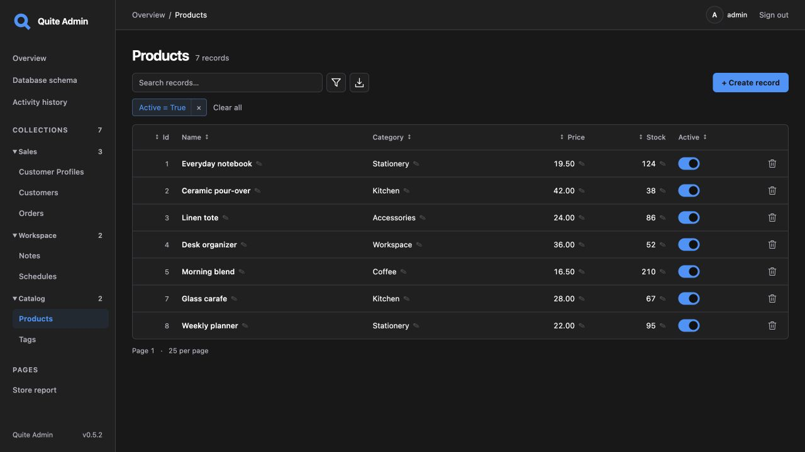

# quite-admin

[](https://github.com/lyova24/quite-admin/releases/latest)
[](https://github.com/lyova24/quite-admin/actions/workflows/ci.yml)
[](https://pypi.org/project/quite-admin/)

**Version: 0.8.14** · [Changelog](https://github.com/lyova24/quite-admin/blob/master/CHANGELOG.md)

**An admin panel for your existing FastAPI or Litestar models.**

Automatically discover collections and forms without writing a separate admin class
for every model. Edit related records, inspect before/after history and export data
from the same interface. No additional Pydantic schemas or DTOs are required.

[Try the browser demo](https://lyova24.github.io/quite-admin/demo/) · [Run your first app](https://lyova24.github.io/quite-admin/en/first-app.html) · [Connect an existing app](https://lyova24.github.io/quite-admin/en/quickstart.html)

[English documentation](https://lyova24.github.io/quite-admin/en/index.html) · [Документация на русском](https://lyova24.github.io/quite-admin/ru/index.html)

Supports **CPython 3.11–3.15**. MIT licensed.

## Add to your existing app

Install into your application's environment:

```bash
pip install 'quite-admin[sqlalchemy,fastapi]'
# For Litestar: uv add 'quite-admin[sqlalchemy,litestar]'
```

Add this beside your existing FastAPI `app`. Replace the database import with your
SQLAlchemy or SQLModel base and session factory:

```python
import os

from quite_admin import Admin, PasswordAuth
from quite_admin.adapters.sqlalchemy import SQLAlchemyAdapter
from myapp.database import Base, SessionFactory

admin = Admin(
    auth=PasswordAuth.single_user("admin", os.environ["QUITE_ADMIN_PASSWORD"]),
    secret_key=os.environ["QUITE_ADMIN_SECRET"],
    adapters=[SQLAlchemyAdapter(SessionFactory, base=Base)],
    secure_cookies=False,  # Local HTTP; keep True for production HTTPS.
)
admin.mount_fastapi(app)
```

Set `QUITE_ADMIN_PASSWORD` and a persistent random `QUITE_ADMIN_SECRET` of at least
32 bytes in your application configuration. Import your model modules before startup,
run the app and open `/admin/`. Sign in as `admin` with the configured password.
For Litestar, replace the last line with `admin.mount_litestar(app)`.

Your application keeps its database lifecycle and migrations. See the
[quickstart](https://lyova24.github.io/quite-admin/en/quickstart.html) and
[deployment guide](https://lyova24.github.io/quite-admin/en/deployment.html).

[](https://lyova24.github.io/quite-admin/demo/)

## Try a complete application

The [single-file example](https://github.com/lyova24/quite-admin/blob/master/examples/quickstart.py)
includes **Customers → Orders → Order items**, sign-in and persistent SQLite data.
Download it and run with uv; its dependency header installs the packages automatically:

```bash
curl -fsSLo quickstart.py https://raw.githubusercontent.com/lyova24/quite-admin/master/examples/quickstart.py
QUITE_ADMIN_PASSWORD='local-demo-only' uv run --script quickstart.py
```

Open [localhost:8000/admin/](http://localhost:8000/admin/), sign in with
`admin` / `local-demo-only`, change an order and inspect **Activity history**.
No repository checkout or Node.js is needed.
[Step-by-step walkthrough and pip alternative](https://lyova24.github.io/quite-admin/en/first-app.html).

To explore without running Python, open the
[browser demo](https://lyova24.github.io/quite-admin/demo/) with `admin` / `admin`.
Its fictional data stays in your browser; **Reset demo** restores it.
[See the interface tour](https://lyova24.github.io/quite-admin/en/interface-tour.html).

## What you get

- Authenticated CRUD with automatic forms, search, sorting and typed filters.
- Inline cell editing and atomic one-to-one, one-to-many and many-to-many relationship editing.
- CSV/XLSX export with column selection, filters and related-table data.
- [Activity history](https://lyova24.github.io/quite-admin/en/storage.html) with before/after
  field values, user and collection filters, configurable recording levels and storage.
- Automatic stale-edit detection, field permissions and server-side write validation.
- Count-free cursor pagination, SQL read deadlines and configurable read concurrency.
- Interactive database schema, grouped navigation and English/Russian UI.
- Type-aware date/time, JSON, multiline text and nullable boolean controls.
- Custom pages, Jinja2 templates, field controls, write hooks, record actions and bulk commands.
- Optional per-model application services, form-only inputs and Pydantic validation.

## Choose your data source

Native adapters support **SQLAlchemy 2.x, SQLModel, Tortoise ORM, Peewee and GINO 1.x**.
Install the matching extra: `sqlalchemy`, `sqlmodel`, `tortoise`, `peewee` or `gino-legacy`.
GINO needs a separate environment from SQLAlchemy 2.x.

**SQL reflection** discovers existing SQL tables without importing ORM models.
The **custom adapter API** can connect another data source or route writes through
your application's services.
[Integration guide](https://lyova24.github.io/quite-admin/en/integration.html) · [Custom adapters](https://lyova24.github.io/quite-admin/en/custom-adapters.html).

Use `pip install quite-admin` for the ORM-independent core. The `pydantic` extra is
only needed for optional per-model form schemas; ordinary model discovery does not need it.

## Compatibility and guarantees

Read the [public API guarantees](https://lyova24.github.io/quite-admin/en/api-stability.html),
[database compatibility matrix](https://lyova24.github.io/quite-admin/en/data-safety.html)
and [dependency compatibility guide](https://lyova24.github.io/quite-admin/en/dependency-compatibility.html)
before adopting quite-admin. Patch releases preserve the documented public API;
adapter and template contracts are versioned.

SQL reflection runs database constraints and triggers. Use a native ORM or application-service
adapter when writes must execute Python ORM hooks or business rules.
[Current limitations](https://lyova24.github.io/quite-admin/en/development.html#current-limitations).

## Development

From a source checkout, run the larger FastAPI or Litestar showcase:

```bash
uv sync --locked
QUITE_ADMIN_PASSWORD='local-demo-only' uv run uvicorn examples.fastapi_app:app --reload
# Or: examples.litestar_app:app
```

Build the English/Russian Diplodoc site with Node.js 24+ and npm 11.5.1+:

```bash
npm ci
npm run docs:build
npm run docs:serve
```

Run the repository checks:

```bash
uv run pytest -q
uv run ruff check src tests examples scripts
uv run ruff format --check src tests examples scripts
```

CI checks CPython 3.11–3.15, with dedicated PostgreSQL/MySQL contracts and isolated
minimum/latest dependency profiles. Tagged releases reuse successful CI for the exact
commit, publish source archives and deploy its documentation artifact; the separate PyPI
workflow builds and validates one wheel/sdist pair before Trusted Publishing.
[Development](https://lyova24.github.io/quite-admin/en/development.html) · [Release policy](https://lyova24.github.io/quite-admin/en/releases.html).
