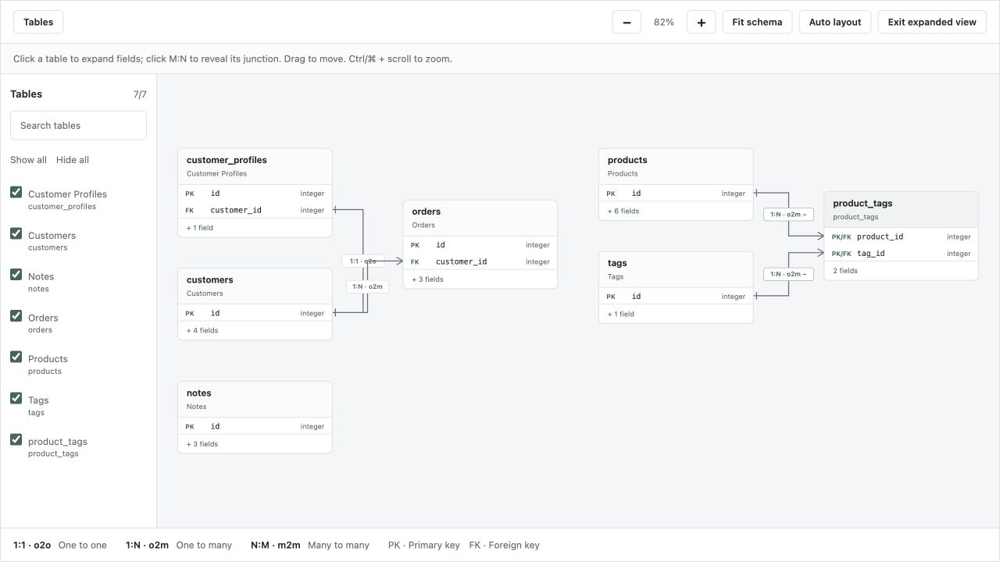

# Interactive database schema

Open **Database schema** in the navigation (`/admin/schema`, or your mount prefix).
The diagram includes every registered collection you can list and view. All these tables
are selected by default, including tables without relationships. It uses adapter metadata;
opening or rearranging the diagram does not read or modify record values.

[](../assets/screenshots/database-schema.png)

## Explore the diagram

- **Tables** opens the sidebar. Search by collection label or table name, use checkboxes
  to choose visible tables, or select **Show all** / **Hide all**. Search narrows the
  sidebar choices without changing the diagram. Clicking a table name centers it.
- Cards initially show primary keys and relationship fields. Click a card, or focus it
  and press Enter/Space, to show its remaining visible fields. Click again to collapse it.
- Lines connect the participating fields. Their labels and end markers distinguish
  **1:1 · o2o**, **1:N · o2m** and **N:M · m2m**. Selecting a table highlights its links.
- Click an **N:M** label to reveal the junction table and its two **1:N** links. Click
  either link's collapse control to return to the logical M:N relationship. If the
  junction is already registered, its existing card is reused. Otherwise its metadata
  card becomes available in the sidebar when revealed.
- Drag a card to move it; drag empty canvas to pan. The wheel pans; Ctrl/⌘ + wheel or
  the +/− buttons zoom. **Fit schema** fits visible tables; **Auto layout** also resets
  manual positions. Moving any table fixes the positions of every visible table until
  **Auto layout** is used. Automatic layout accounts for expanded cards and disconnected groups.
- **Expand view** gives the diagram the available window area; Escape exits it. On narrow
  screens the table sidebar starts collapsed. **Open collection** opens the selected
  registered table's record list.

Keyboard users can move a focused table with arrow keys (Shift moves farther), expand
it with Enter/Space and activate junction labels with Enter/Space. Focus the canvas and
use +/− to zoom or 0 to fit. Selection, expansion, visibility and positions last only
while this page is open; reloading selects all authorized registered tables again.

## Permissions and field policy

The schema requires authentication and both `list` and `view` permission for each
collection. Relationships to unavailable collections and links through hidden join fields
are omitted. Field visibility follows `ModelOptions`, including the default exclusion of
credential fields. A restricted registered junction cannot reappear as a synthetic card.

An unregistered junction exposes only its adapter-supplied field metadata, with credential
fields excluded. It has no record-list link or CRUD operations. Register/configure the
junction as a collection if it needs application-specific field restrictions.

The page uses the same theme tokens as lists and forms; see [interface customization](styling.md).
Its packaged JavaScript is allowed by a page-specific SHA-256 CSP hash and SRI. Custom
pages retain their existing script policy.

## Custom adapters

Existing `RelationAdapter.relations()` metadata is sufficient for basic links. Optional
`Relation.source_key_fields` and `target_key_fields` describe the actual join columns,
including alternate unique keys. `through` identifies an M:N junction; `junction` supplies
its fields and the foreign keys on each side:

```python
from quite_admin import Field, Junction, Relation

Relation(
    name="tags", target=Tag, kind="many_to_many",
    source_key_fields=("id",), target_key_fields=("id",), through="product_tags",
    junction=Junction(
        name="product_tags",
        fields=(
            Field("product_id", int, primary_key=True),
            Field("tag_id", int, primary_key=True),
        ),
        source_fields=("product_id",), target_fields=("tag_id",),
        model=ProductTag,  # optional: identifies a registered junction model
    ),
)
```

Junction metadata does not require a primary key. Optional sync/async
`schema_relations(model)` can provide diagram-specific metadata without changing the
relationships available for editing. Built-in SQLAlchemy discovery also includes physical
foreign keys without an ORM `relationship()`. Adapter API version 1 is unchanged.
