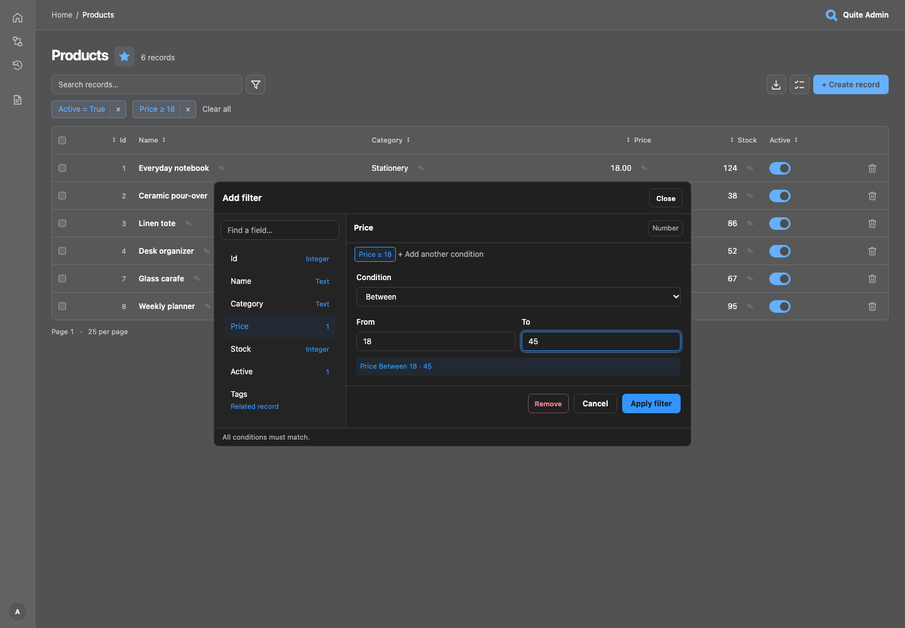

# List filters

Find **Alex** without knowing a surname: open the square funnel button, choose **Name**,
leave **Contains** selected, enter `Alex` and apply. It matches `Alex Smith` and `alex Brown`.
Filtering runs in the database before counting and pagination, and CSV/XLSX exports use
exactly the same conditions. It works with both ORM adapters and SQL reflection.

The modal keeps a searchable field list on the left and the selected field's condition
and values on the right. Field types, a condition preview and existing conditions stay
visible. Click an active chip to edit it, × to remove it, or **Add another condition**
to constrain the same scalar field again. Close, Cancel, Escape and clicking the backdrop
leave the current filters unchanged. Date controls and all colors follow the admin theme.

[](../assets/screenshots/filters.png)

## Common tasks

| Task | Field and condition |
|---|---|
| Find Alex without a surname | Text → **Contains** `Alex` (default, ignores case) |
| Exclude test accounts | Text → **Does not contain** `test` |
| Find an email domain or prefix | Text → **Ends with** `@example.com` or **Starts with** `Alex` |
| Match a complete code | Text/UUID → **Equals** |
| Select pending and paid orders | Status → **Is one of** → check both values |
| Exclude one status or amount | Choice/number → **Does not equal** |
| Find prices from 10 through 50 | Number → **Between**; both endpoints are included |
| Find stock below 5 or dates after a cutoff | Number/date/time → **Less than** / **Greater than** |
| Find all events on a day, including late at night | Datetime → **On date** (default) |
| Find inactive accounts | Boolean → **Equals** → **False** |
| Find a missing value | Nullable field → **Is NULL** |
| Find an explicitly blank note | Text → **Is empty text**; SQL NULL is separate |
| Find orders belonging to a customer | Related record → search a name or exact ID, then select |

Text also offers exact inequality, a set of exact values and **Is not empty text**.
UUID fields offer equality, inequality and sets. JSON/binary/unsupported fields offer
only NULL checks when nullable. Choices offer a searchable checklist for **Is one of**;
other scalar fields accept one value per line (up to 100). Decimal values and large
identifiers stay strings in the browser, preserving their precision.

All conditions combine with **AND**. Values within **Is one of** combine with **OR**.
For example, `Name contains Alex` AND `Name does not contain test` AND
`Status is one of [pending, paid]`. Arbitrary nested OR groups are not supported.
**Clear all** resets filters and search while retaining sorting and page size. Search,
sort and page links preserve conditions; the URL can be bookmarked or shared with an
authorized user. Applying or removing a filter resets pagination.

## Text, dates and missing values

Partial text conditions ignore case; `%`, `_` and `!` are literal characters, not wildcards.
Exact equality and Unicode/accent matching follow the database's types and collation.
Negative comparisons exclude SQL NULL. Use **Is NULL** explicitly for missing values;
empty text means `""`, not SQL NULL or JSON null. Whitespace-only text is not empty.

**On date** becomes `timestamp >= day start AND timestamp < next day start`.
Leave the UTC offset blank for database-local naive time, or supply `Z` / `±HH:MM` for
an explicit offset. The offset is fixed for both bounds; there is no named-timezone or
DST conversion. **Between** takes two inclusive bounds; use **At least** / **At most**
for one-sided ranges. Datetime/time comparisons accept ISO values with optional offsets.

Invalid values, reversed ranges and excessive condition counts keep inputs and return
HTTP 422. Unknown/hidden fields, unsupported operators and duplicate parameter names
return 400. Repeated conditions use distinct URL names such as `f.name.icontains~1`;
the editor allocates these automatically. Without JavaScript or native dialog support,
an expandable form remains available. Blank fallback inputs add no condition; sets use
a JSON array of strings in this fallback. Existing exact/range/NULL URLs keep working.

## Choose fields

```python
from quite_admin import ModelOptions

admin.configure("products", options=ModelOptions(
    filter_fields=("name", "active", "category", "price", "stock"),
    search_fields=("name",),
))
```

`filter_fields=None` exposes supported visible scalar fields; `()` disables scalar
controls. Configured order is preserved. Excluded and automatically hidden sensitive
fields remain unavailable even if named explicitly. Read-only fields can be filtered.
Labels use `FieldOptions`; choices come from field metadata. Up to 50 database scalar predicates and 10
relationship conditions are allowed; **Between** and **On date** each use two predicates.
Custom adapters keep their existing operators unless they opt into the extended set.

## Related records

Registered relationships appear beside scalar fields when the adapter supports
`Query.related`. Search the target table, then select one existing record. The
list includes records linked to that target: 1:1, N:1, 1:N and M:N are supported.
Different relationships combine with AND; one target is selected per relationship.

Lookup searches visible `search_fields` (visible text fields by default), plus an
**exact primary key** with built-in adapters. Numeric and UUID IDs work even when only
names are configured as searchable. For a composite key, enter a complete JSON object,
for example `{"tenant_id": "7", "code": "alex"}`. Text matches and the exact-key match
are combined before pagination. A human-readable label, searchable text and visible ID
make results identifiable even with `record_label="id"`. The hint names the actual
searchable fields; a hidden key is neither searched by the ID shortcut nor displayed.
Results load 25 at a time, with a typing delay, pagination and Retry on failure.

Both ends must be registered with the same adapter. Parent list and target list/view
permissions are required; edit permission is unnecessary. `ModelOptions.relations` and
field visibility still apply, and every lookup repeats permission checks. The editor
uses integrity-checked self-hosted scripts with exact CSP hashes; arbitrary scripts
stay blocked. [Relationship forms](relationships.md) use the same lookup endpoint.

## Adapter queries

```python
from decimal import Decimal
from quite_admin import Filter, Query, RelatedFilter

page = await adapter.list(Product, Query(
    filters=(
        Filter("name", "icontains", "Alex"),
        Filter("price", "gte", Decimal("10.00")),
        Filter("status", "in", ("pending", "paid")),
    ),
    related=(RelatedFilter("tags", {"id": 17}),),
    limit=25,
))
```

Relation names come from `adapter.relations(Product)`, never raw SQL. Target keys use
Python types, including UUID and composite keys. Optional capabilities for custom adapters
are described in [the adapter contract](custom-adapters.md#filters-and-columns).

The main listing search runs after a 900 ms typing pause; IME composition waits until
complete and Enter searches immediately. It pauses while the filter modal is open.
Apply includes the current search text; cancel resumes a pending search. Without
JavaScript use Enter in the search form.
