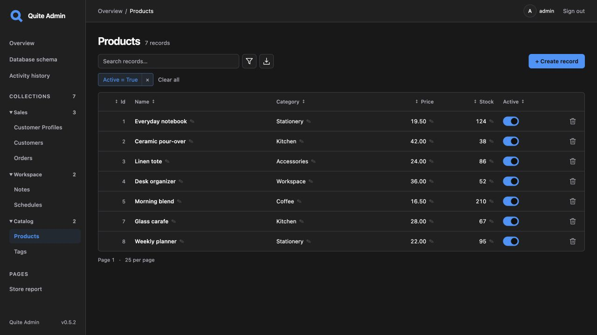

# quite-admin

**An admin panel for your existing FastAPI or Litestar models.**

Automatically discover collections and forms without writing a separate admin class
for every model. Edit related records, inspect before/after history and export data
from the same interface. No additional Pydantic schemas or DTOs are required.

## Start here

| Your next step | Start with |
| --- | --- |
| Explore the interface without installing anything | [Open the browser demo](https://lyova24.github.io/quite-admin/demo/), `admin` / `admin` |
| Run a complete Python application | [Your first admin](first-app.md): three related models, sign-in and SQLite |
| Connect models you already have | [Add to an existing app](quickstart.md): FastAPI or Litestar |

[Русский](../ru/index.md) · [GitHub](https://github.com/lyova24/quite-admin) · [PyPI](https://pypi.org/project/quite-admin/)

## Work with your data

- **Manage records:** generated forms, inline cell editing, typed filters, search and sorting.
- **Edit relationships:** searchable 1:1, 1:N and M:N editors with atomic saves and stale-edit detection.
- **Review and share changes:** activity history with before/after values, CSV/XLSX export and an interactive database schema.

The [interface tour](interface-tour.md) walks through the controls. The
[browser demo guide](browser-demo.md) explains what runs in the browser and what needs
an actual Python application.

## Use your application's models and rules

Native adapters support **SQLAlchemy 2.x / SQLModel, Tortoise ORM, Peewee and GINO 1.x**.
With SQL reflection, you can discover physical tables without importing model classes.
With a service adapter, writes can use your application's existing business operations.
[Choose your integration](integration.md) or [connect a custom adapter](custom-adapters.md).

Your application keeps its accounts, database lifecycle and migrations. Configure
collections and fields in Python, add business actions when needed and customize templates
without replacing your models. The library supports **CPython 3.11–3.15** and is MIT licensed.

## Find a guide

The sidebar follows the same order: **Getting started → Integrations → User guide →
Customization → Deployment → Reference**. Repository development instructions are under
**Contributing**.

| Task | Guide |
| --- | --- |
| Choose columns, editable fields and collection groups | [Collections and fields](configuration.md) |
| Find records and edit their relationships | [Filters](filters.md), [related records](relationships.md) |
| Export matching data and linked columns | [CSV/XLSX export](exports.md) |
| Change the language, colors or layout | [Language and appearance](customization.md), [styles](styling.md) |
| Add a page, control, business action or service | [Custom pages](custom-pages.md), [field controls](field-widgets.md), [hooks and services](extensions.md) |
| Use application accounts and restrict access | [Authentication and permissions](authentication.md) |
| Persist history and configure deployment | [Deployment](deployment.md), [storage and history](storage.md) |

## Before deployment

Review the [database compatibility matrix and limits](data-safety.md),
[dependency compatibility](dependency-compatibility.md) and [public API guarantees](api-stability.md).
Use the [deployment guide](deployment.md) to configure accounts, sessions, write rules,
service storage and the host lifecycle.

SQL reflection runs database rules and triggers. Python ORM hooks and service-layer rules
require a native or service adapter. The compatibility guides distinguish verified paths
from unverified combinations.
