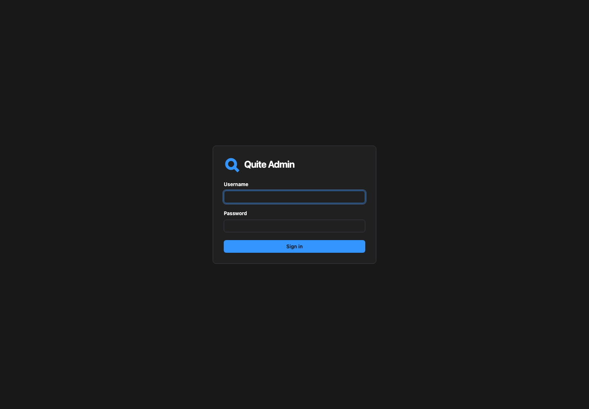
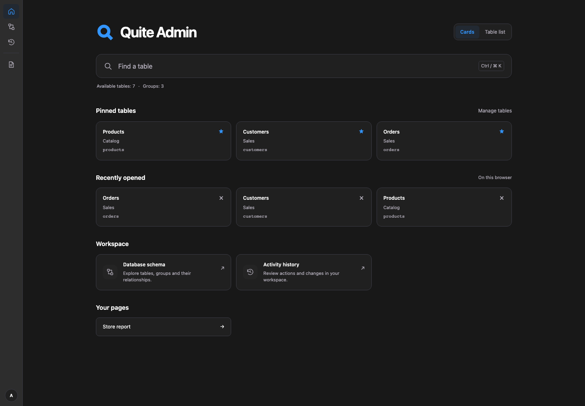
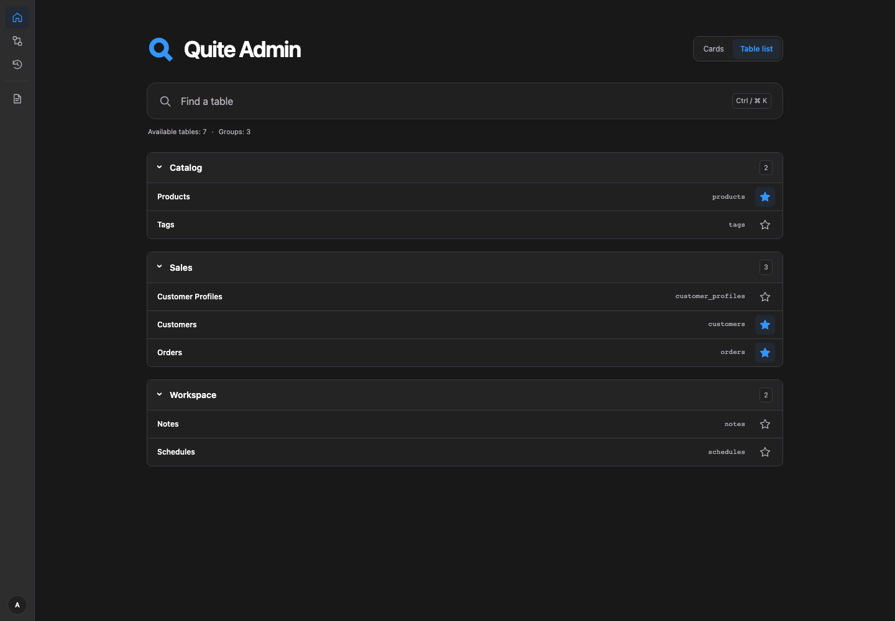
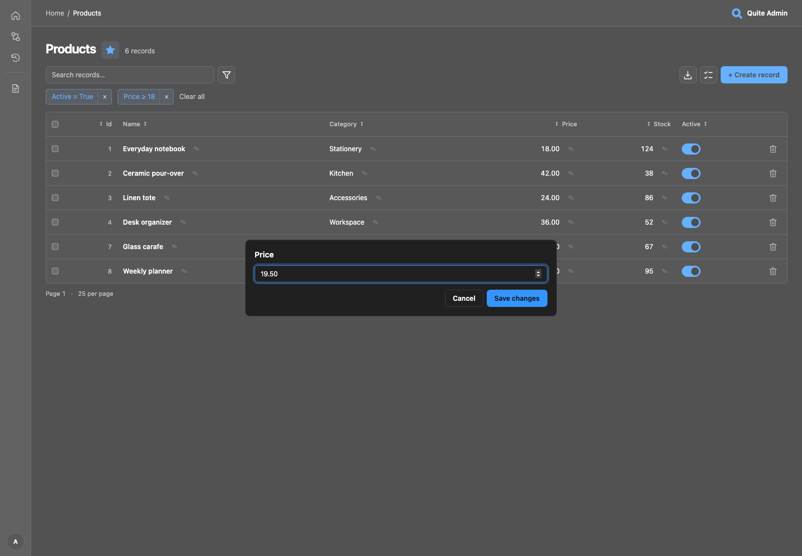
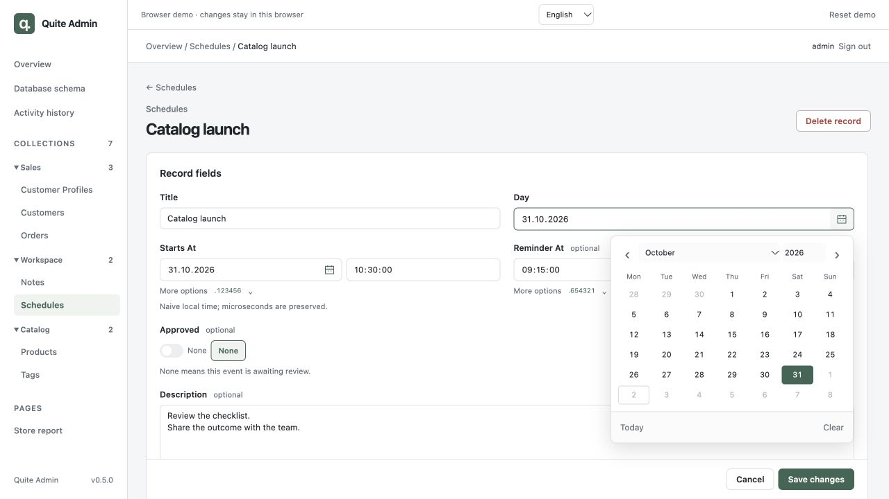
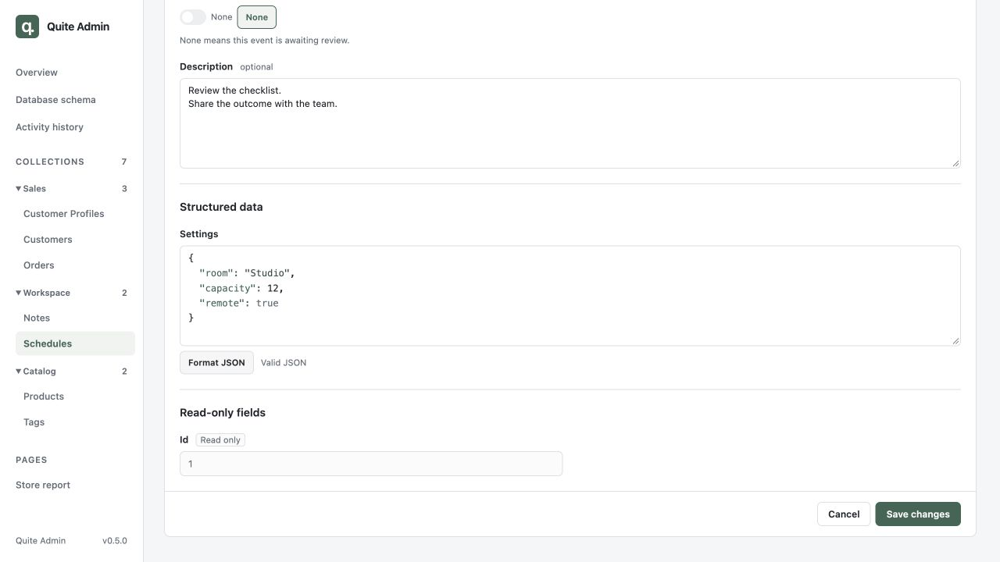
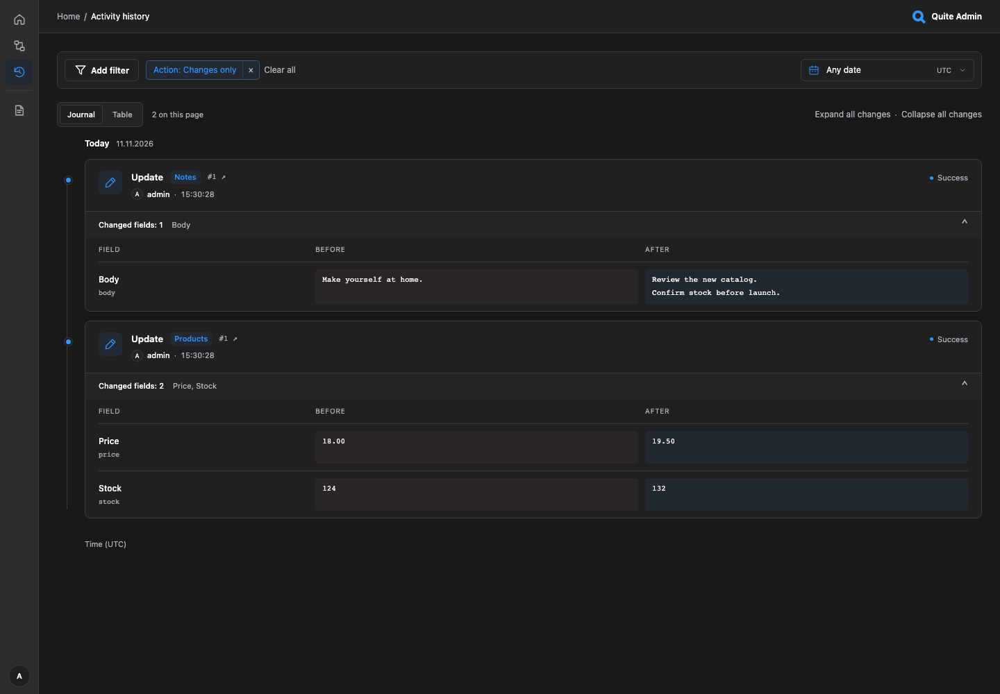
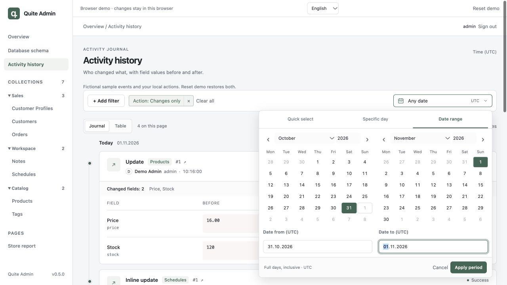

# Interface tour

The screenshots show the [local Python example](quickstart.md#run-the-sample-application)
with fictional records and the default charcoal-and-blue palette. You can also open the
[browser demo](https://lyova24.github.io/quite-admin/demo/) with `admin` / `admin`.
Both demos use ordinary admin pages with fictional data. See [demo coverage](browser-demo.md)
for the features that need the Python application.

Select any screenshot to view it at full size.

## Sign in and navigate

The compact sign-in card places the logo beside the application title.
Custom logos use the same alignment.

These two examples offer an optional walkthrough after sign-in. **Start tour** begins
navigation and highlights controls on real admin pages; **Not now** or closing the
invitation leaves the current page in place and is remembered. The walkthrough does
not create, edit or delete records. **Back** and **Next** move through steps;
**Skip tour** and **Close** end it on the current page. **Finish** completes the walkthrough,
returns to Home and remembers completion. It supports the keyboard and narrow screens.
Choose **Start tour** in the avatar's profile menu to restart explicitly. Dismissal is
remembered, and a new tab does not start it automatically. Active progress survives
the walkthrough's navigation and reloads in the same tab.

After acceptance, a thin rounded frame marks the current control while the surrounding
page is dimmed. The spotlight follows scrolling and resizing; page controls remain clickable.

The steps cover Home, list controls, a product form, relationships, the existing
calendar, exports, schema and history. The database-schema step frames the diagram
with its tables and relationships. The examples opt into this walkthrough;
ordinary `Admin` instances do not load it. The browser demo accepts `?lang=en` or
`?lang=ru`; the Python example uses `QUITE_ADMIN_LANGUAGE`.

**Home** shows the configured admin logo, title and description. The **Cards** view is
selected by default: it brings together pinned and recently opened tables, plus shortcuts
to the schema, activity history and custom pages. The full table catalog is available
in **Table list**, keeping Cards focused on shortcuts. Opening Home uses authorized
metadata without scanning table records or querying record counts.

In this view, cards use three equal-width columns on desktop. One or two cards keep the
same width instead of filling the row. Tablet screens use two columns and narrow
screens use one.

Choose **Table list** in the Home view switcher to browse all permitted tables in one
compact list organized by group, similar to Django admin. Groups start expanded and
can be collapsed individually; each table link shows its label and technical name.
The browser remembers the selected view separately for your user and admin mount.
Switching between views leaves pinned and recent tables unchanged.

Choose **Find a table** or press **Ctrl/⌘ K** on any authenticated page. The search
opens with its input focused and matches table labels, technical names and groups.
Use arrows and Enter to open a result; Escape closes search and returns focus.
Stars in **Table list**, search results, record-list headings and pinned Home
cards share the same pinned-table state. Select an unfilled star to pin a table on
Home, or a filled star to unpin it. The star does not open the table. Up to 12 pinned
and 8 recent table identifiers are stored per user and admin mount in this browser;
Home displays the six most recent tables. Permissions are checked again on every page.
Search terms and record data are not stored.

Use the × button on a recently opened table to remove it from that list. This
leaves its pinned state unchanged. Opening the table again adds it back to recent tables.

If you cannot remember a name, choose **Table list** and browse the full catalog by
group. The catalog works with native keyboard navigation. Without JavaScript, the
view switcher and catalog stars stay hidden, and the native **All tables** dropdown
remains available on Home. If browser storage is unavailable, switching views still
works for the current page.

The left navigation is a permanent **3.5 rem icon rail** for Home, Database schema,
Activity history and custom pages. It has no expandable table panel or resize handle.
The avatar stays at the bottom: click it to open your name and **Sign out** to its right.
On authenticated pages other than Home, the header shows the admin logo and title
on the right. Breadcrumbs use the plain text **Home** link and the current table
or record for context. Home keeps its branding in the main content.

## Edit without leaving the list

Open **Products**, click the pencil beside **Price**, enter `19.50` and **Save changes**.
The cell updates in place. **Cancel** or Escape discards an unsaved value. The **Active**
switch saves immediately. Open **Schedules** to try a nullable **Approved** switch;
∅ sets it to NULL, distinct from false. Click any noninteractive area of a row to open
the full record. Pencils, switches, bulk-selection controls and links to related records
or other destinations keep their own actions without opening the row's record.

When you open a record or a related record from a listing, the return link leads back
to that original list with its search, filters, sort order and page preserved. Saving
or running a record action keeps this return context; deleting returns to the original
list. If that target is invalid or you no longer have access, return links use the
record's own table instead.

These use the same field controls as record forms. Concurrent changes are checked before
saving. To try a conflict, open the same record in two tabs, save one, then submit the other.
The second form retains its draft and offers **Reload record**.
[Configuration](configuration.md) explains `list_editable`, field policies and revisions.

## Dates, time and structured data

The record heading, form and actions stay aligned in one centered container. Short
fields sit side by side on wider screens and stack on narrow screens; text areas,
JSON and relationship editors use the full width. Read-only values have their own
section, and the save/cancel footer remains available as you scroll. For selecting
one or many linked records, see [search and selection](relationships.md#search-and-selection).

On Home, choose **Table list → Schedules → Create record**, or use **Find a table**
to open Schedules. **Date**, **Date and time** and optional **Time** are editable immediately.
Click the calendar icon next to Date, or the date part of Date and time, to open the
existing in-page calendar. Fill the title and required date/time values, then choose
**Create record**.

To inspect existing values, open **Schedules → Catalog launch**. Date is DATE; Date and
time combines date and time; Time is optional TIME. Select a day in the calendar, then
save the record. There is no extra calendar Apply step in forms. **More options** reveals
the original six fractional digits and an optional UTC offset; opening the form preserves
precision. The example's SQLite columns use naive local values, without a timezone.

**Description** demonstrates a full-width TEXT textarea. Below it, **Settings** has JSON
highlighting, syntax feedback and **Format JSON**. Edit valid JSON and save; invalid JSON
cannot be persisted. **Approved** explicitly distinguishes NULL from true/false.

In the Schedules list, choose **Add filter → Date → Between** for a two-endpoint calendar.
DATETIME/TIME ranges include time. Filter Apply/Cancel operates on a draft; record calendars
update their form field immediately. Details are in [field controls](configuration.md)
and [list filters](filters.md).

## Explore fields and relationships {#try-the-feature-guide}

Open these fictional tables through **Table list** on Home or **Find a table**.
They use the same lists and record forms as an application connected to quite-admin.

| Example | What to try |
| --- | --- |
| Field samples | Open Field control showcase. Change Status, inspect Public UUID and URL/issue links, expand multiline/JSON previews and use the Issue suggestions. Create a sample to try model defaults; timestamps and binary values remain read-only. |
| Folders | Open Catalog folder. Search the Parent or Children picker, use Next to browse 36 candidates and remove a nullable selection. Samples is a read-only relationship. |
| Customers / Customer Profiles / Orders | Inspect a customer's 1:1 profile and 1:N orders; a profile's or order's customer uses a single-record selector. |
| Products / Tags | Add several tags to a product, search for another tag and remove a chip. The selection stays visible while results change. |
| Regional prices | Create a new Region + SKU combination, then edit its price. Both key fields become read-only. |
| Price alerts | Choose Regional Price once to fill its Region + SKU foreign key. The target price lists its Alerts. |
| Reference rates | Open a fictional rate and inspect the view-only form; create, save and delete controls are absent. |

A single relationship offers **Choose a record** or **Change selection**; multiple
relationships offer **Choose records**. Select radio buttons for one record or checkboxes
for several. Selected records have a count and individual remove buttons;
**Clear selection** clears the draft. Save the form to apply links. Required relationships
cannot be detached, and removing a link never deletes its target record.

Price alerts demonstrates a required foreign key with two columns: its **Regional Price**
picker selects Region and SKU together. To find the original US price exactly, search
`{"region":"US","sku":"NOTE-001"}`. Both parts of the visible identity distinguish it
from the EU and GB prices for the same SKU.

In **Field samples**, run **Publish sample** or **Archive sample** below the form and
inspect Status and Activity history. In **Products**, select rows, open **Bulk actions**
and choose **Deactivate products**. Review the confirmation, then the result for each
record. Each record is processed separately: a failed item does not undo successful
items. Bulk deletion uses the same confirmation flow.

The Python **Demo accounts** table demonstrates a form-only **New password**, Pydantic
validation and create/update application services. Create a fictional account with a
lowercase username and an 8–128 character password. On edit, leave New password empty
to retain the existing hash. The password and hash are never displayed. These accounts
do not sign in to the admin. The browser demo keeps this table read-only because it
does not run the Python services or password hashing.

Try a negative Quantity/Ratio in Field samples or Price in Regional prices: saving
fails with validation feedback. The Python example enforces this with a pre-write
hook; the browser uses local checks. [Demo coverage](browser-demo.md) distinguishes
these local interactions from server authentication, CSRF, authorization and transactions.

## Find who changed a value

Open **Activity history**. The default **Journal** groups events by day and shows field
names with **Before / After** values. Your saved price and boolean changes appear under
your signed-in user; expand an event or **Expand all changes**. The browser demo also
includes fictional sample events.

Choose **Add filter → User** and select `admin` in the local Python example, or
Demo Admin / Olivia Chen in the browser demo. Add **Table**, **Action** or **Result**
through the same editor as list filters. The period sits in the
same toolbar: use a quick preset, a **Specific day**, or a **Date range**. Both range
endpoints include the entire UTC day. Switching to **Table** preserves these selections.

The Python example sets `history_level="audit"`: try signing in, exporting CSV or
submitting an invalid value to inspect authentication, export and failed-write events
alongside committed changes. The library's default remains `"changes"`; `"all"` also
records reads. Its default SQLite file needs a persistent writable directory;
SQLite/PostgreSQL/MySQL storage is configurable.
`Admin(history_enabled=False, ...)` disables the feature. Read
[storage and history](storage.md) for permissions, redaction, backups and durability limits.

## Navigate and export

On Home, choose **Table list** and select a table from its group. Collapse groups you
do not need to keep the list compact. **Orders** illustrates cursor-style paging; its
real ASGI counterpart uses database keysets and signed cursors without exact counts.

In **Products**, apply a filter, open **Export data**, select columns and download CSV.
It contains all matches, including other pages. Related columns such as Tags → Name
are available in both demos; multiple linked values occupy separate lines in one CSV
cell. Use the local ASGI example for **XLSX** and database batching;
[exports](exports.md) documents limits and batching.

Finally, change a product's tags on its record page and explore **Database schema**:
expand fields, toggle **N:M** to reveal `product_tags`, and move a table. **Auto layout**
releases the fixed positions. Both the [relationship editor](relationships.md) and
[schema](database-schema.md) show the same registered tables and relationships.

The schema fills the available height below the header. Its wider table picker
keeps long names readable and scrolls on short screens. Schemas with more than
100 permitted tables still start with manual selection; the layout does not enable
all tables automatically. See [schema selection](database-schema.md#initial-selection-for-large-databases).
