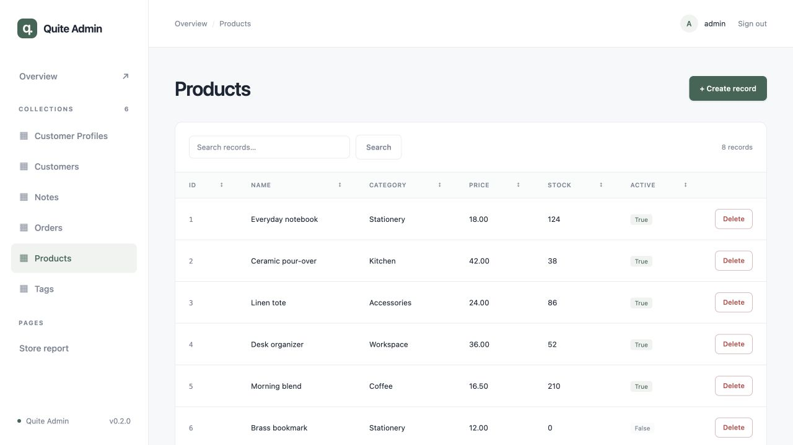
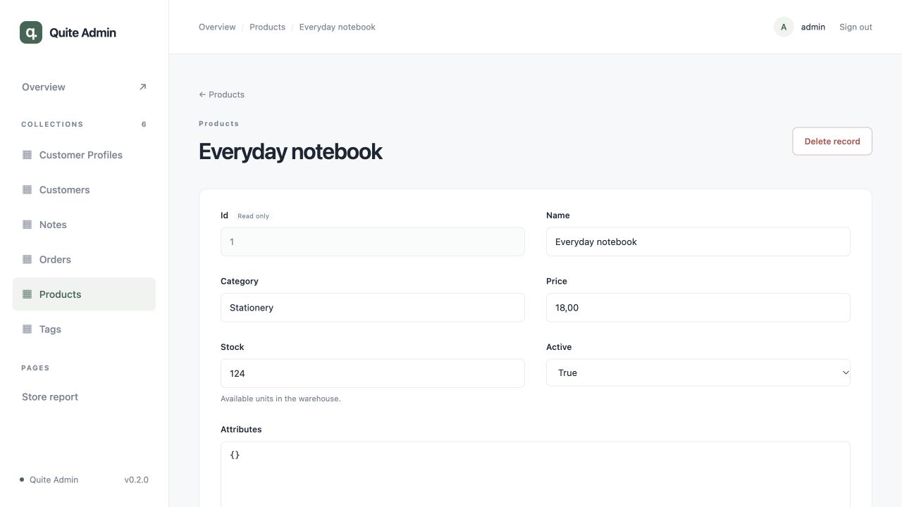
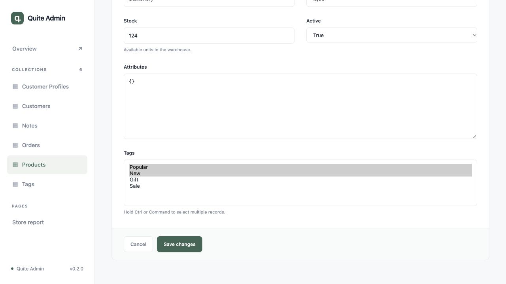
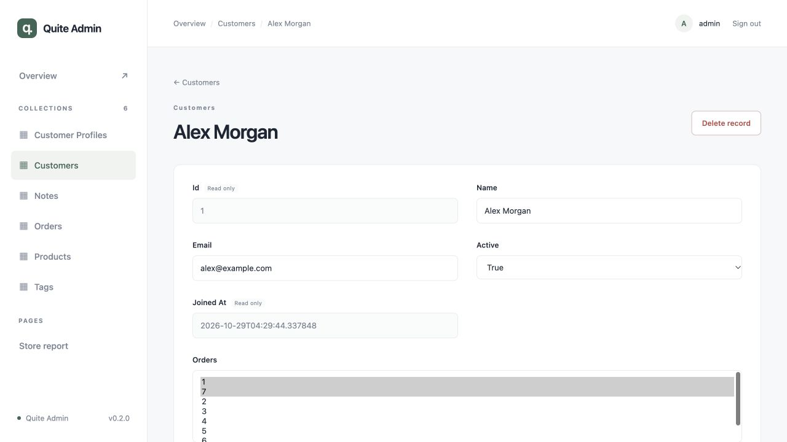

# Add an admin in two minutes

Use CPython **3.11–3.15** and your existing application, database and models.
The package has no published release yet; install this checkout into the application's
virtual environment:

```bash
pip install '/path/to/quite-admin[sqlalchemy,fastapi]'
# For Litestar: pip install '/path/to/quite-admin[sqlalchemy,litestar]'
```

## Existing FastAPI application

Add this next to the code that already creates `app`. Replace the import with your
existing SQLAlchemy/SQLModel base and session factory:

```python
import os
from quite_admin import Admin, PasswordAuth
from quite_admin.adapters.sqlalchemy import SQLAlchemyAdapter
from myapp.database import Base, SessionFactory

admin = Admin(
    auth=PasswordAuth.single_user('admin', os.environ['QUITE_ADMIN_PASSWORD']),
    secret_key=os.environ['QUITE_ADMIN_SECRET'],
    adapters=[SQLAlchemyAdapter(SessionFactory, base=Base)],
    secure_cookies=False,  # Local HTTP development; use True with production HTTPS.
)
admin.mount_fastapi(app)
```

Set `QUITE_ADMIN_PASSWORD` and a persistent random `QUITE_ADMIN_SECRET` of at least
32 bytes in your normal application configuration. Import your model modules before
startup. Run your application as usual and open `/admin/`; sign in as `admin` with
the configured password. No duplicate schemas or admin model classes are needed.
Your application continues to own its database lifespan and migrations.

## Existing Litestar application

Use the same `Admin` configuration and replace the mount call:

```python
admin.mount_litestar(app)
```

Mount before the application starts. For Tortoise, initialize it in the host lifespan
before model discovery; select `TortoiseAdapter` instead. See [integration](integration.md)
for all adapters, nested mounts and proxies.

## Any ORM through its database

Pass an engine connected to the existing database to discover physical tables:

```python
from quite_admin.adapters.sql import SQLAdapter
adapter = SQLAdapter(engine)
```

Use `adapters=[adapter]` in `Admin`. Reflection runs database rules and triggers;
Python ORM hooks and service rules require a native or service adapter. Review
[default secret/service field protection](configuration.md) and the
[database compatibility matrix](data-safety.md) before exposing collections.

## See the interface



The record page contains both scalar fields and relationship editors. The read-only
field example shows the same page with a protected registration date.







[Watch the 12-second walkthrough (MP4)](../assets/walkthrough.mp4).

## Run the sample application

```bash
uv sync --locked --python 3.15
QUITE_ADMIN_PASSWORD='local-demo-only' uv run uvicorn examples.fastapi_app:app --reload
# Or use examples.litestar_app:app.
```

Open [localhost:8000/admin/](http://localhost:8000/admin/) and sign in with
`admin` / `local-demo-only`. This creates an isolated sample SQLite database;
`QUITE_ADMIN_DEMO_DB` can select a different path. Use uv 0.13.6+ to download stable
Python 3.15. The Python package does not need Node.js; only documentation builds do.
