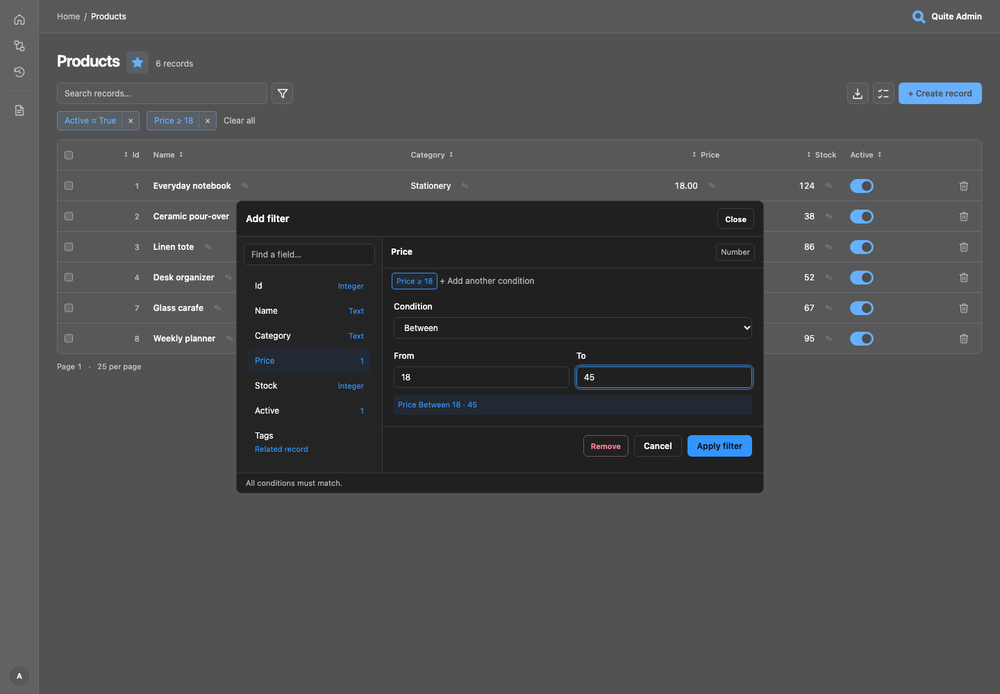

# Фильтры списков

Чтобы найти **Alex**, не зная фамилии, откройте квадратную кнопку с воронкой, выберите
**Имя**, оставьте **Содержит**, введите `Alex` и примените. Найдутся `Alex Smith` и
`alex Brown`. Фильтрация выполняется в БД до подсчёта и пагинации, а выгрузка CSV/XLSX
использует те же условия. Работает как с ORM, так и с SQL reflection.

Слева в модалке — список полей с поиском, справа — условие и значения выбранного поля.
Видны тип, предпросмотр и уже добавленные условия. Нажмите метку, чтобы отредактировать
условие, × — удалить, **Добавить ещё условие** — ограничить то же скалярное поле повторно.
Закрыть, Отмена, Escape и нажатие на фон оставляют фильтры без изменений. Календарь и
цвета соответствуют теме админки.

[](../assets/screenshots/filters.png)

## Типовые задачи

| Задача | Поле и условие |
|---|---|
| Найти Alex без фамилии | Текст → **Содержит** `Alex` (по умолчанию, без учёта регистра) |
| Исключить тестовые аккаунты | Текст → **Не содержит** `test` |
| Найти домен почты или префикс | Текст → **Заканчивается на** `@example.com` или **Начинается с** `Alex` |
| Найти полный код | Текст/UUID → **Равно** |
| Выбрать ожидающие и оплаченные заказы | Статус → **Одно из значений** → отметить оба значения |
| Исключить статус или сумму | Выбор/число → **Не равно** |
| Найти цены от 10 до 50 включительно | Число → **Между** |
| Найти остаток меньше 5 или даты после границы | Число/дата/время → **Меньше** / **Больше** |
| Найти все события за день, включая поздний вечер | Datetime → **За дату** (по умолчанию) |
| Найти неактивные аккаунты | Boolean → **Равно** → **Нет** |
| Найти отсутствующее значение | Nullable-поле → **Равно NULL** |
| Найти явно пустую заметку | Текст → **Пустая строка**; SQL NULL проверяется отдельно |
| Найти заказы клиента | Связанная запись → поиск по имени или точному ID, затем выбор |

Для текста также доступны точное неравенство, набор точных значений и **Непустая строка**.
UUID поддерживает равенство, неравенство и набор значений. JSON/binary/неподдержанный тип —
только проверки NULL для nullable. Для choices условие **Одно из значений** показывает чекбоксы
с поиском; для других скалярных полей — ввод по одному значению на строку (до 100).
Decimal и большие идентификаторы передаются из браузера строками без потери точности.

Все условия объединяются **AND**. Значения внутри **Одно из значений** объединяются **OR**.
Например, `Имя содержит Alex` AND `Имя не содержит test` AND
`Статус — одно из [pending, paid]`. Произвольных вложенных OR-групп нет.
**Сбросить всё** очищает фильтры и поиск, сохраняя сортировку и размер страницы. Поиск,
сортировка и ссылки страниц сохраняют условия; URL можно сохранить или передать
пользователю с доступом. Применение и удаление условия сбрасывают пагинацию.

## Текст, даты и отсутствующие значения

Поиск части текста не учитывает регистр; `%`, `_` и `!` означают обычные символы.
Точное равенство, Unicode и сравнение акцентов зависят от типов и collation БД.
Отрицательные сравнения исключают SQL NULL. Для отсутствующего значения выберите
**Равно NULL**. Пустой текст — это `""`, а не SQL NULL или JSON null.
Строка из пробелов не считается пустой.

**За дату** превращается в `timestamp >= начало дня AND timestamp < начало следующего дня`.
Оставьте UTC-смещение пустым для локального naive-времени БД или задайте `Z` / `±HH:MM`.
Смещение фиксировано для обеих границ; преобразования именованных часовых поясов и DST
нет. **Между** включает обе границы; **Не меньше** / **Не больше** задают одну границу.
Datetime/time принимают ISO-значения с необязательным смещением.

Неверные значения, обратный диапазон и превышение числа условий сохраняют ввод и
возвращают HTTP 422. Неизвестные/скрытые поля, неподдержанные операторы и повторяющиеся
имена параметров возвращают 400. Повторные условия используют разные имена URL,
например `f.name.icontains~1`; редактор назначает их автоматически. Без JavaScript или
поддержки dialog остаётся раскрываемая форма. Пустой контрол не добавляет условие;
набор значений в этой форме вводится JSON-массивом строк. Старые URL с равенством,
диапазонами и NULL продолжают работать.

## Выбор полей

```python
from quite_admin import ModelOptions

admin.configure("products", options=ModelOptions(
    filter_fields=("name", "active", "category", "price", "stock"),
    search_fields=("name",),
))
```

`filter_fields=None` показывает поддержанные видимые скалярные поля; `()` отключает их
контролы. Порядок настройки сохраняется. Исключённые и автоматически скрытые секретные
поля недоступны даже при явном указании. Read-only поля доступны для фильтрации.
Подписи задаются через `FieldOptions`, choices — метаданными поля. Допускается до 50 скалярных предикатов
БД и 10 условий по связям; **Между** и **За дату** занимают по два предиката.
Свои адаптеры сохраняют прежние операторы, пока явно не подключат расширенный набор.

## Связанные записи

Связи появляются рядом со скалярными полями, если адаптер поддерживает `Query.related`.
Найдите и выберите существующую целевую запись. Список покажет записи, связанные с ней:
поддержаны 1:1, N:1, 1:N и M:N. Разные связи объединяются AND; для каждой выбирается
одна целевая запись.

Поиск использует видимые `search_fields` (по умолчанию текстовые поля) и **точный
первичный ключ** во встроенных адаптерах. Числовой и UUID ID находятся, даже если для
текстового поиска настроено только имя. Составной ключ вводится полным JSON-объектом,
например `{"tenant_id": "7", "code": "alex"}`. Текстовые совпадения и точное совпадение
ключа объединяются до пагинации. Человекочитаемая подпись, поисковый текст и видимый ID
позволяют различать результаты даже при `record_label="id"`. Подсказка перечисляет
реальные поисковые поля; скрытый ключ не ищется через ID и не отображается.
Результаты загружаются по 25 с задержкой после ввода, пагинацией и повтором при ошибке.

Обе стороны должны быть зарегистрированы одним адаптером. Нужны list исходной таблицы
и list/view целевой; edit не требуется. Действуют `ModelOptions.relations` и видимость
полей; каждый запрос повторно проверяет права. Редактор использует собственные скрипты
с SRI и точными CSP-хешами; произвольные скрипты запрещены.
[Формы связей](relationships.md) используют тот же endpoint поиска.

## Запрос адаптера

```python
from decimal import Decimal
from quite_admin import Filter, Query, RelatedFilter

page = await adapter.list(Product, Query(
    filters=(
        Filter("name", "icontains", "Alex"),
        Filter("price", "gte", Decimal("10.00")),
        Filter("status", "in", ("pending", "paid")),
    ),
    related=(RelatedFilter("tags", {"id": 17}),),
    limit=25,
))
```

Имена связей берутся из `adapter.relations(Product)`, а не raw SQL. Ключи используют
Python-типы, включая UUID и составные ключи. Необязательные возможности своих адаптеров
описаны в [контракте адаптера](custom-adapters.md).

Основной поиск списка запускается после 900 мс без ввода; IME сначала завершается,
Enter ищет сразу. Пока модалка фильтров открыта, автопоиск приостановлен. Применение
учитывает текущий текст поиска; отмена возобновляет ожидающий поиск. Без JavaScript
отправляйте поисковую форму клавишей Enter.
