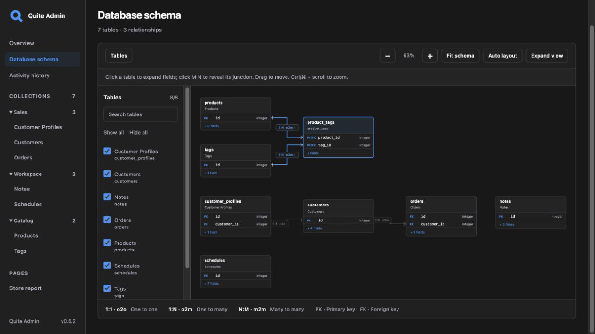

# quite-admin

Версия **0.6.0** (в разработке): встраиваемая админка для **FastAPI** и **Litestar**, поддерживающая **CPython 3.11–3.15**.
Нативные адаптеры ORM: **SQLAlchemy 2.x, SQLModel, Tortoise ORM, Peewee и GINO 1.x**.
Также поддерживаются SQL reflection без импорта моделей и собственные сервисные адаптеры.
Коллекции, поля и формы собираются из существующих SQL-таблиц или моделей ORM.
Дополнительные Pydantic-модели, DTO и классы `ModelAdmin` не нужны. MIT License.

[English](../en/index.md) · [Быстрый старт](quickstart.md) · [Демо в браузере](browser-demo.md) · [Обзор интерфейса: 0.5.2](interface-tour.md)

**Возможности:** CRUD и правки ячеек · история со значениями «было → стало» · поиск, сортировка и типизированные фильтры по полям и связям · атомарные редакторы 1:1/1:N/M:N · защита от устаревших сохранений · общие контролы дат/времени · подсветка JSON · группы коллекций · интерактивная схема БД · права на поля · авторизация/CSRF · EN/RU интерфейс · темы/шаблоны · хуки записи и действия над записями.

## С чего начать

| Задача | Руководство |
|---|---|
| Подключить своё приложение | [Быстрый старт](quickstart.md), затем [интеграция и адаптеры](integration.md) |
| Попробовать интерфейс без запуска Python | [Демо в браузере](browser-demo.md), `admin` / `admin` |
| Настроить столбцы, поля и права | [Коллекции и поля](configuration.md), [авторизация](authentication.md) |
| Изменить цвета, плотность и шаблоны | [Кастомизация оформления](styling.md) |
| Проверить поддержку БД и ограничения | [Доступ к данным и совместимость](data-safety.md) |

В **0.5.0** добавлены [сервисное хранилище и история действий](storage.md),
общие контролы дат/времени, cursor-списки без точного COUNT и таймауты SQL-чтения.
[Обзор интерфейса](interface-tour.md) показывает актуальные экраны.
Версия зафиксирована **2026-11-02**.

В исходной версии **0.5.2** используются новые тёмно-серая [палитра и логотип](customization.md),
единые отступы страниц и выровненный заголовок входа. Скриншоты в руководствах показывают
этот интерфейс.

| Новый сценарий | Где попробовать и настроить |
| --- | --- |
| Посмотреть значения полей до/после действия пользователя | [Пример истории](interface-tour.md), [хранилище, права и флаг](storage.md) |
| Править ячейки, boolean, DATE/DATETIME/TIME, TEXT и JSON | [Schedules и Products в демо](browser-demo.md), [контролы полей](configuration.md) |
| Группировать коллекции и открывать большие таблицы | [Группы и cursor pagination](configuration.md) |
| Ограничивать чтение и исключить запрос на каждую связанную запись | [Таймауты SQL](configuration.md), [пакетный экспорт связей](exports.md) |

## Работа с данными

- Просматривайте, создавайте, редактируйте и удаляйте записи на единой странице или правьте доступные ячейки списка.
- Проверяйте [действия по пользователю и таблице](storage.md): сравнения полей по дням,
  виды Журнал/Таблица и включительные фильтры дня/диапазона UTC.
- Ищите, сортируйте и перелистывайте списки. [Добавляйте фильтры](filters.md) по значениям,
  диапазонам, SQL NULL и связанным записям; редактируйте условия через активные чипы.
- [Редактируйте связи](relationships.md) с поиском и пагинацией вариантов. Скалярные поля
  и выбранные связи сохраняются одной атомарной операцией.
- [Обнаруживайте конкурентные изменения](configuration.md#konkuriruyushee-redaktirovanie):
  устаревшая форма возвращает 409 и сохраняет введённые значения для проверки перед перезагрузкой.
- Изучайте [схему базы данных](database-schema.md): автоматическая компоновка, ключевые поля,
  раскрываемые карточки, типы связей и промежуточные таблицы M:N. Боковая панель выбирает
  видимые таблицы; перемещение любой фиксирует все видимые позиции до **Автокомпоновки**.

## Выбор источника данных

| Режим | Источник схемы | Когда использовать |
|---|---|---|
| SQL reflection | Таблицы и колонки самой БД | Любая ORM поверх SQL или приложение без ORM; модели импортировать не нужно |
| ORM adapter | Существующие классы ORM | Нужны Python defaults, типы моделей и их persistence hooks |
| Сервисный адаптер | Собственный repository или сервис | Запись должна выполнять бизнес-правила приложения |

Встроены адаптеры SQLAlchemy 2.x / SQLModel, Tortoise ORM, Peewee и
[GINO 1.0.x / PostgreSQL](gino.md). GINO использует отдельный extra `gino-legacy` с
SQLAlchemy 1.3. [Контракт адаптера](custom-adapters.md) позволяет подключать другие источники.
Независимое ядро и SQL reflection дают доступ к SQL-базам без предположений о произвольном
Python API ORM.

## Настройка интерфейса

[Настройки коллекций и полей](configuration.md) задают подписи, видимость, read-only
поля и доступные операции. [Авторизация и права](authentication.md), CSRF и проверка
полей выполняются на сервере.

Выберите английский или русский язык, настройте [название и палитру](customization.md),
[типографику, плотность и шаблоны](styling.md). Для задач приложения добавляйте
[свои страницы](custom-pages.md), [контролы полей, хуки записи и действия](extensions.md).

## Совместимость и разработка

Последний зафиксированный релиз — **0.5.2** (**2026-11-02**). Перед внедрением проверьте
[совместимость и ограничения](data-safety.md), [разработку](development.md) и
[политику релизов](releases.md).

| Проект | Подходящий сценарий |
|---|---|
| quite-admin | Автообнаружение SQL-схемы, FastAPI/Litestar, Peewee/GINO, несколько ORM или сервисный адаптер; гарантии публичного API и явно указанные ограничения |
| [SQLAdmin](https://github.com/smithyhq/sqladmin) | SQLAlchemy/SQLModel views, sync/async engine и WTForms с FastAPI/Starlette |
| [Starlette Admin](https://github.com/jowilf/starlette-admin) | Contrib model views, MongoDB, bulk actions, файлы и import/export |

Выбор основан на документированных способах подключения.
[Матрица ORM/СУБД](data-safety.md) различает проверенные пути и неподтверждённые сочетания.
