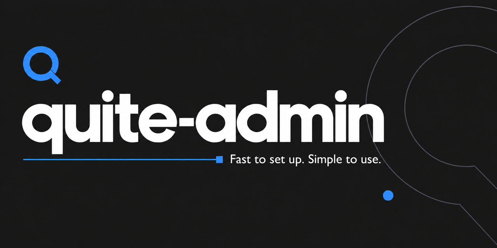
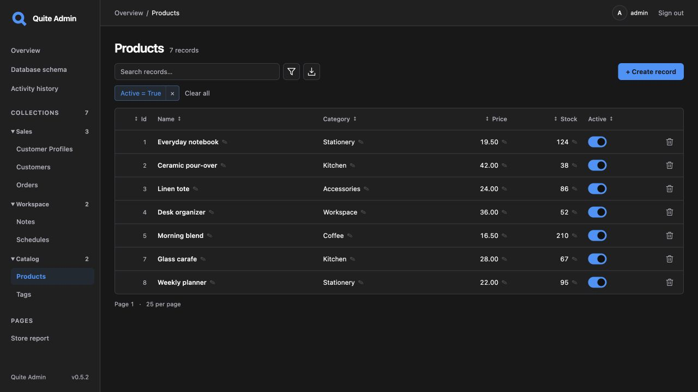

# quite-admin

**Админка для существующих моделей FastAPI или Litestar.**

Таблицы и формы собираются автоматически: отдельный admin-класс для каждой модели
не нужен. Редактируйте связанные записи, проверяйте историю «было → стало» и выгружайте
данные из одного интерфейса. Дополнительные Pydantic-схемы и DTO не требуются.

## С чего начать

| Ваш следующий шаг | Куда перейти |
| --- | --- |
| Познакомиться с интерфейсом без установки | [Открыть браузерное демо](https://lyova24.github.io/quite-admin/demo/), `admin` / `admin` |
| Запустить готовое Python-приложение | [Ваша первая админка](first-app.md): три связанные модели, вход и SQLite |
| Подключить готовые модели | [Подключение к своему приложению](quickstart.md): FastAPI или Litestar |

[English](../en/index.md) · [GitHub](https://github.com/lyova24/quite-admin) · [PyPI](https://pypi.org/project/quite-admin/)

## Работа с данными

- **Управление записями:** автоматические формы, правки ячеек, типизированные фильтры, поиск и сортировка.
- **Редактирование связей:** редакторы 1:1, 1:N и M:N с поиском, атомарным сохранением и защитой от устаревших правок.
- **Проверка и передача изменений:** история со значениями до/после, экспорт CSV/XLSX и интерактивная схема БД.

[Обзор интерфейса](interface-tour.md) знакомит с контролами.
[Руководство браузерного демо](browser-demo.md) объясняет, что работает в браузере,
а для чего нужно настоящее Python-приложение.

## Модели и правила вашего приложения

Встроены адаптеры **SQLAlchemy 2.x / SQLModel, Tortoise ORM, Peewee и GINO 1.x**.
SQL reflection обнаруживает физические таблицы без импорта классов моделей.
Сервисный адаптер позволяет выполнять запись через существующие бизнес-операции приложения.
[Выберите интеграцию](integration.md) или [подключите свой адаптер](custom-adapters.md).

Аккаунты, lifespan базы и миграции остаются у вашего приложения. Настраивайте таблицы
и поля на Python, добавляйте бизнес-действия и меняйте шаблоны без замены моделей.
Библиотека поддерживает **CPython 3.11–3.15**, лицензия — MIT.

## Найти руководство

Боковая навигация идёт по порядку: **Начало работы → Интеграции → Руководство пользователя →
Настройка и расширение → Развёртывание → Справочник**. Инструкции для авторов изменений
в репозитории находятся в разделе **Разработка библиотеки**.

| Задача | Руководство |
| --- | --- |
| Выбрать колонки, редактируемые поля и группы таблиц | [Таблицы и поля](configuration.md) |
| Найти записи и изменить их связи | [Фильтры](filters.md), [связанные записи](relationships.md) |
| Выгрузить подходящие данные и связанные столбцы | [Экспорт CSV/XLSX](exports.md) |
| Изменить язык, цвета или компоновку | [Язык и оформление](customization.md), [стили](styling.md) |
| Добавить страницу, контрол, бизнес-действие или сервис | [Свои страницы](custom-pages.md), [контролы полей](field-widgets.md), [хуки и сервисы](extensions.md) |
| Подключить аккаунты приложения и ограничить доступ | [Авторизация и права](authentication.md) |
| Сохранить историю и настроить развёртывание | [Развёртывание](deployment.md), [хранилище и история](storage.md) |

## Перед развёртыванием

Проверьте [матрицу совместимости БД и ограничения](data-safety.md),
[совместимость зависимостей](dependency-compatibility.md) и [гарантии API](api-stability.md).
[Руководство по развёртыванию](deployment.md) поможет настроить аккаунты, сессии,
правила записи, служебное хранилище и lifespan хоста.

SQL reflection выполняет правила и триггеры самой БД. Для Python-хуков ORM и правил
сервисного слоя нужен нативный или сервисный адаптер. Руководства по совместимости
различают проверенные пути и неподтверждённые сочетания.
