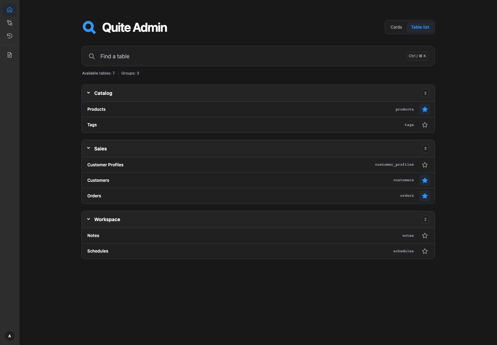
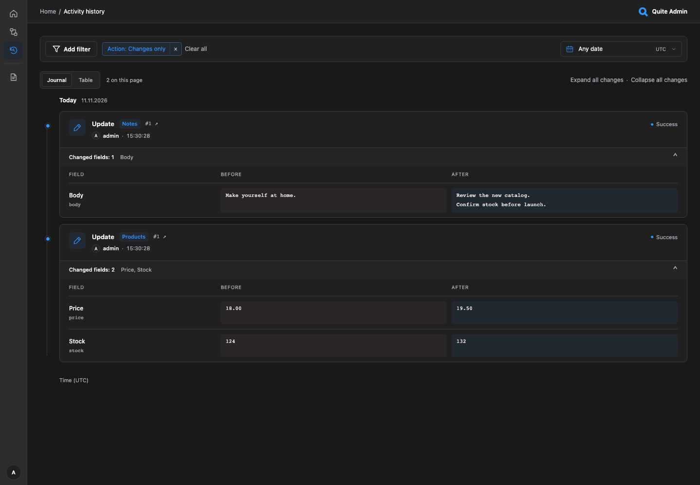

# Обзор интерфейса

Скриншоты показывают [локальный Python-пример](quickstart.md#zapusk-gotovogo-primera) с вымышленными
записями и стандартной тёмно-серой палитрой с синим акцентом. Можно также открыть
[браузерное демо](https://lyova24.github.io/quite-admin/demo/) с `admin` / `admin`.
В обоих демо используются обычные страницы админки с вымышленными данными. В разделе [возможностей демо](browser-demo.md)
указано, для чего нужно Python-приложение.

Нажмите на скриншот, чтобы открыть его в полном размере.

## Вход и навигация

В компактной карточке входа логотип расположен слева от названия приложения.
Свой логотип использует такое же выравнивание.

Оба примера после входа предлагают необязательный тур. **Начать тур** запускает
переходы и подсветку контролов на настоящих страницах админки; **Не сейчас** или
закрытие приглашения оставляют текущую страницу и запоминаются. Тур не создаёт,
не изменяет и не удаляет записи. **Назад** и **Далее** переключают шаги;
**Пропустить тур** и **Закрыть** заканчивают тур на текущей странице. **Завершить**
запоминает прохождение и возвращает на главную. Поддерживаются клавиатура и узкие экраны. Выберите **Начать тур** в меню профиля у аватара для явного повторного
запуска. Отказ запоминается, новая вкладка не запускает тур автоматически.
Активный шаг сохраняется при переходах тура и перезагрузках в той же вкладке.

После согласия текущий контрол выделяется тонкой скруглённой рамкой, а остальная
страница затемняется. Подсветка следует за прокруткой и изменением размера окна;
контролы страницы остаются доступными для нажатия.

Шаги показывают главную, контролы списка, форму товара, связи, существующий календарь,
экспорт, схему и историю. На шаге схемы базы данных рамка выделяет саму диаграмму
с таблицами и связями. Примеры явно подключают этот тур; обычные экземпляры `Admin`
его не загружают. Браузерное демо принимает `?lang=en` или `?lang=ru`, Python-пример
использует `QUITE_ADMIN_LANGUAGE`.

**Главная** показывает заданные в админке логотип, название и описание. По умолчанию
выбран вид **Карточки**: в нём собраны закреплённые и недавно открытые таблицы, переходы
к схеме, истории действий и настроенным страницам. Полный каталог доступен в виде
**Список таблиц**, а карточки остаются быстрыми переходами. Главная использует
разрешённые метаданные без чтения записей таблиц и запросов их количества.

В этом виде на компьютере карточки занимают три равные колонки. Одна или две карточки
сохраняют ту же ширину, а не растягиваются на весь ряд. На планшетах остаются две
колонки, на узких экранах — одна.

Выберите **Список таблиц** в переключателе вида на главной, чтобы просмотреть все
доступные таблицы одним компактным списком по группам, как в Django admin. Изначально
группы раскрыты; каждую можно свернуть отдельно. Ссылка на таблицу показывает подпись
и техническое имя. Браузер запоминает выбранный вид отдельно для пользователя и админки.
Переключение между видами не меняет закреплённые и недавно открытые таблицы.

Нажмите **Найти таблицу** или **Ctrl/⌘ K** на любой странице после входа. В модальном
окне поле поиска сразу получает фокус. Поиск учитывает подпись, техническое имя и группу.
Стрелки и Enter открывают результат, Escape закрывает окно и возвращает фокус.
Звёздочки в **Списке таблиц**, результатах поиска, заголовках списков записей и
закреплённых карточках главной показывают общее состояние закрепления. Пустая
звёздочка закрепляет таблицу на главной, заполненная — открепляет. Нажатие на неё
не открывает таблицу. Браузер хранит только идентификаторы до 12 закреплённых и
8 недавних таблиц отдельно для пользователя и админки; на главной видны шесть
последних таблиц. Права перепроверяются на каждой странице. Поисковые запросы и записи
не сохраняются.

Кнопка × у недавно открытой таблицы удаляет её только из этого списка, сохраняя
закрепление. Если снова открыть таблицу, она вернётся в недавние.

Если забыли название, выберите **Список таблиц** и просмотрите полный каталог по
группам. Каталог доступен с клавиатуры. Без JavaScript переключатель вида и звёздочки
каталога скрыты, а на главной остаётся нативный раскрывающийся блок **Все таблицы**.
Если хранилище браузера недоступно, переключение работает в пределах текущей страницы.

Слева остаётся постоянная **полоса значков шириной 3.5 rem**: главная, схема БД,
история и свои страницы. Разворачиваемой панели таблиц и изменения ширины нет.
Аватар находится снизу; нажатие открывает справа имя пользователя и кнопку **Выйти**.
На страницах после входа, кроме главной, справа в шапке показаны логотип и название
админки. Хлебные крошки содержат обычную текстовую ссылку **Главная** и текущую
таблицу или запись. На главной логотип и название остаются в основном содержимом.

## Правки прямо в списке

Откройте **Products**, нажмите карандаш у **Price**, введите `19.50` и **Сохранить изменения**.
Ячейка обновится на месте. **Отмена** и Escape отбрасывают несохранённое значение.
Переключатель **Active** сохраняет сразу. В **Schedules** есть nullable-переключатель
**Approved**: ∅ задаёт NULL, отдельно от false. Нажмите на любую неинтерактивную область
строки, чтобы открыть полную запись. Карандаши, переключатели, элементы массового выбора
и ссылки на связанные записи или другие страницы выполняют своё действие без открытия записи строки.

Если открыть запись или связанную запись из списка, ссылка возврата ведёт в исходный
список с сохранением поиска, фильтров, сортировки и страницы. Сохранение и действия
над записью сохраняют этот путь возврата, а удаление возвращает в исходный список.
Если адрес возврата некорректен или доступ к нему потерян, ссылка ведёт в таблицу
текущей записи.

Используются те же контролы, что и в форме записи. Перед сохранением проверяются конкурентные
изменения. Для конфликта откройте запись в двух вкладках, сохраните одну, затем вторую.
Вторая форма сохранит черновик и предложит **Перезагрузить запись**.
[Конфигурация](configuration.md) описывает `list_editable`, правила полей и ревизии.

## Даты, время и структурированные данные

Заголовок записи, форма и действия выровнены в одном контейнере по центру. Короткие
поля расположены рядом на широком экране и друг под другом на узком; многострочный
текст, JSON и редакторы связей занимают всю ширину. Значения только для чтения
собраны отдельно, а панель сохранения и отмены доступна при прокрутке. О выборе
одной или нескольких связанных записей — в разделе [поиска и выбора](relationships.md#poisk-i-vybor).

На главной откройте **Список таблиц → Schedules → Создать запись** или используйте
**Найти таблицу**, чтобы открыть Schedules. Поля **Дата**, **Дата и время** и необязательное
**Время** сразу доступны для изменения. Нажмите значок календаря рядом с Дата или
частью даты в Дата и время: откроется существующий календарь внутри страницы.
Укажите название, заполните обязательные дату/время и нажмите **Создать запись**.

Для просмотра существующих значений откройте **Schedules → Catalog launch**. Дата — DATE,
Дата и время — дата со временем, Время — необязательное TIME. Выберите день в календаре
и сохраните запись. Отдельного шага «Применить» в календаре формы нет. **Дополнительно**
раскрывает исходные шесть дробных цифр и необязательное UTC-смещение; открытие формы
сохраняет точность. SQLite-столбцы примера содержат локальные значения без часового пояса.

**Description** показывает многострочный TEXT на всю ширину. Ниже **Settings** демонстрирует
подсветку JSON, проверку синтаксиса и **Форматировать JSON**. Измените валидный JSON и сохраните;
невалидный JSON сохранить нельзя. **Approved** явно различает NULL и true/false.

В списке Schedules выберите **Добавить фильтр → Дата → Между**: откроется календарь
с двумя границами. Диапазоны DATETIME/TIME включают время. Применить/Отмена в фильтре
работают с черновиком, а календарь записи сразу меняет поле формы. Подробнее —
[контролы полей](configuration.md) и [фильтры списков](filters.md).

## Примеры возможностей

Открывайте эти вымышленные таблицы через **Список таблиц** на главной или **Найти таблицу**.
Они используют те же списки и формы записей, что и приложение, подключённое к quite-admin.

| Пример | Что попробовать |
| --- | --- |
| Field samples | Откройте Field control showcase. Измените Status, проверьте Public UUID и ссылки URL/issue, раскройте многострочный текст/JSON и подсказки Issue. Создайте образец со значениями модели по умолчанию; время и binary остаются только для чтения. |
| Folders | Откройте Catalog folder. В Parent или Children запустите поиск, нажмите Далее для просмотра 36 вариантов и уберите nullable-связь из выбора. Samples — связь только для чтения. |
| Customers / Customer Profiles / Orders | Проверьте профиль клиента 1:1 и заказы 1:N; клиент профиля или заказа выбирается одиночным селектором. |
| Products / Tags | Добавьте товару несколько тегов, найдите ещё один и уберите чип. Выбор остаётся виден при изменении результатов поиска. |
| Regional prices | Создайте новое сочетание Region + SKU и измените цену. Оба ключевых поля после создания доступны только для чтения. |
| Price alerts | Одним выбором Regional Price задайте внешний ключ Region + SKU. Целевая цена показывает свои Alerts. |
| Reference rates | Откройте вымышленный курс и проверьте форму только для просмотра; кнопок создания, сохранения и удаления нет. |

Для одиночной связи доступны **Выбрать запись** или **Изменить выбор**, для
множественной — **Выбрать записи**. Радиокнопки выбирают одну запись, флажки —
несколько. Выбранные записи имеют счётчик и отдельные кнопки удаления;
**Очистить выбор** очищает черновик. Сохраните форму, чтобы применить связи.
Обязательные связи отвязать нельзя; удаление связи не удаляет связанную запись.

Price alerts показывает обязательный внешний ключ из двух столбцов: **Regional Price**
выбирает Region и SKU вместе. Для точного поиска исходной цены US введите
`{"region":"US","sku":"NOTE-001"}`. Обе части видимого ключа отличают её от цен EU и GB
того же SKU.

В **Field samples** выполните **Publish sample** или **Archive sample** под формой и
проверьте Status и историю действий. В **Products** выберите строки, откройте
**Массовые действия** и укажите **Deactivate products**. Проверьте подтверждение,
затем результат каждой записи. Записи обрабатываются отдельно: ошибка одной
не отменяет успешные изменения других. Массовое удаление использует тот же
сценарий подтверждения.

Таблица **Demo accounts** в Python показывает поле **New password** только в форме,
Pydantic-валидацию и create/update-сервисы приложения. Создайте вымышленный аккаунт
с именем в нижнем регистре и паролем длиной 8–128 символов. При изменении оставьте
New password пустым, чтобы сохранить прежний хеш. Пароль и хеш не показываются.
Эти аккаунты не используются для входа в админку. В браузерном демо таблица доступна
только для чтения: оно не выполняет Python-сервисы и хеширование пароля.

Попробуйте отрицательные Quantity/Ratio в Field samples или Price в Regional prices:
сохранение завершится ошибкой проверки. Python-пример проверяет это хуком перед
записью, браузер — локальной проверкой. [Покрытие демо](browser-demo.md) различает
эти взаимодействия и серверную аутентификацию, CSRF, права и транзакции.

## Кто изменил значение

Откройте **История действий**. По умолчанию **Журнал** группирует события по дням и показывает
названия полей и значения **Было / Стало**. Сохранённые правки цены и boolean появятся
от имени пользователя, под которым выполнен вход. Раскройте событие или
**Развернуть все изменения**. В браузерном демо также есть вымышленные события.

Через **Добавить фильтр → Пользователь** выберите `admin` в локальном Python-примере
или Demo Admin / Olivia Chen в браузерном демо. Добавьте **Таблицу**, **Действие** или
**Результат** тем же редактором, что и в листингах.
Период находится в той же полосе: быстрый пресет, **Конкретный день** или **От–до**.
Обе границы включают целиком соответствующий день UTC. Переключение на **Таблица** сохраняет выбор.

Python-пример использует `history_level="audit"`: войдите, скачайте CSV или отправьте
невалидное значение, чтобы увидеть события аутентификации, экспорта и ошибок записи
рядом с завершёнными изменениями. В библиотеке по умолчанию остаётся `"changes"`;
уровень `"all"` также записывает чтения. Для SQLite-файла нужен постоянный доступный
для записи каталог; можно выбрать SQLite/PostgreSQL/MySQL.
`Admin(history_enabled=False, ...)` выключает функцию. Права, скрытие чувствительных данных,
резервные копии и ограничения надёжности описаны в [хранилище и истории](storage.md).

## Навигация и экспорт

На главной выберите **Список таблиц** и откройте таблицу в нужной группе. Сверните
ненужные группы, чтобы сократить список. **Orders** показывает переходы в стиле
cursor pagination; в ASGI-примере работают keyset-запросы БД и подписанные курсоры без точного COUNT.

В **Products** примените фильтр, откройте **Экспорт данных**, выберите столбцы и скачайте CSV.
Он содержит все совпадения, включая другие страницы. Связанные столбцы вроде
Tags → Name доступны в обоих демо; несколько значений связи занимают отдельные строки
одной CSV-ячейки. Для **XLSX** и пакетных чтений БД запустите локальный ASGI-пример.
Лимиты и пакетные чтения описаны в [экспорте](exports.md).

Затем измените теги товара на странице записи и откройте **Схема БД**: раскройте поля,
нажмите **N:M**, чтобы увидеть `product_tags`, переместите таблицу. **Автокомпоновка**
снимает фиксацию позиций. [Редактор связей](relationships.md) и [схема](database-schema.md)
показывают одни и те же зарегистрированные таблицы и связи.

Схема занимает доступную высоту под шапкой. В более широкой панели выбора удобнее
читать длинные названия; на невысоких экранах панель прокручивается. При наличии более
100 доступных таблиц сначала нужен ручной выбор. Подробнее — в [начальном выборе схемы](database-schema.md#nachalnyj-vybor-dlya-bolshih-baz-dannyh).
