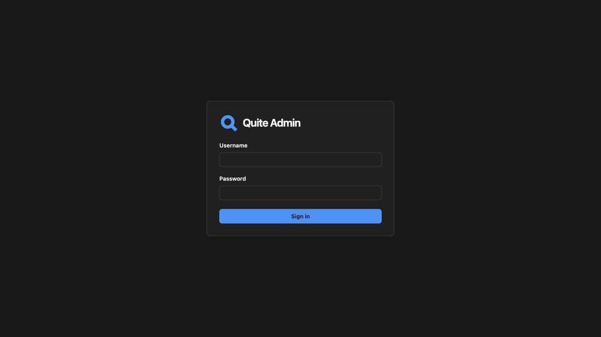
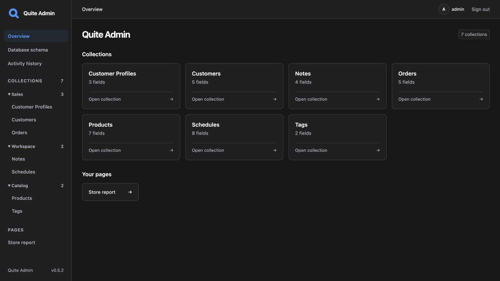
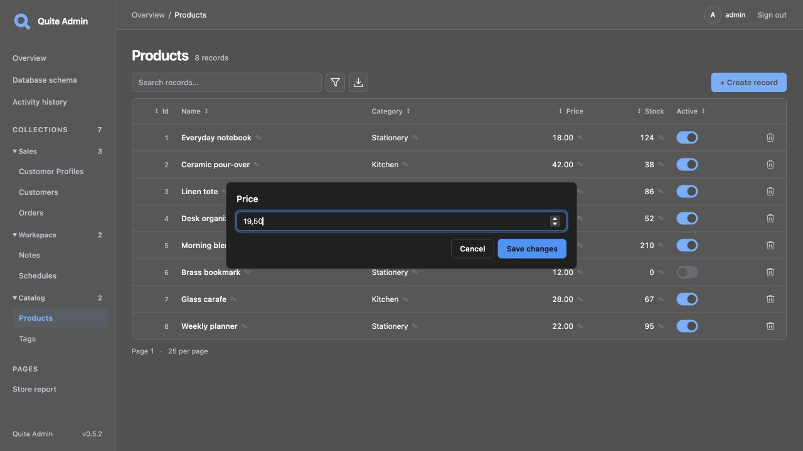
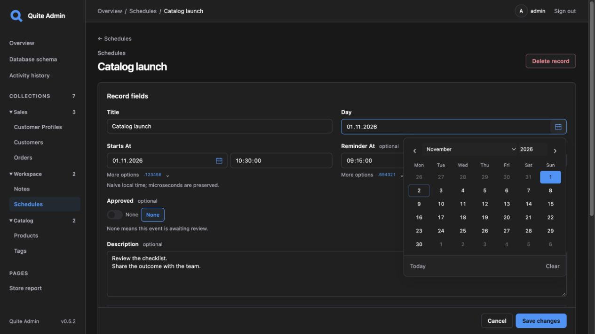
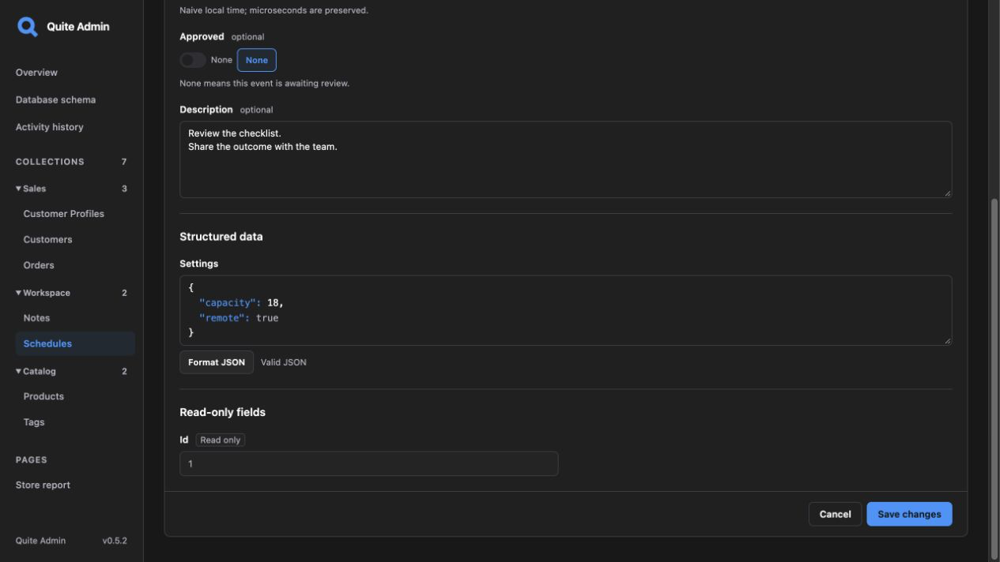
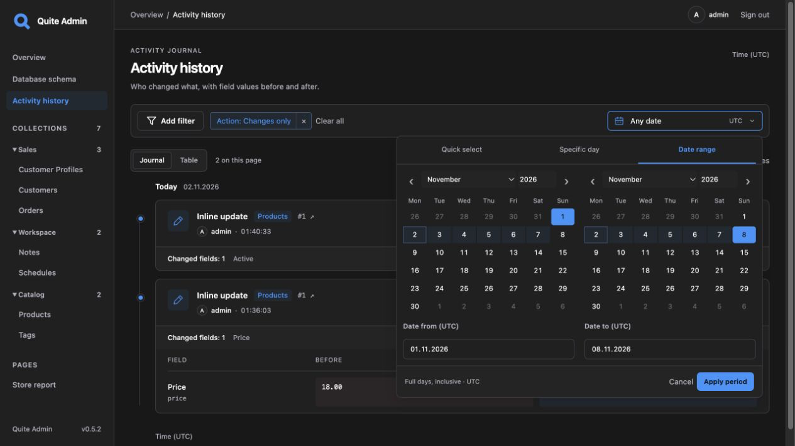

# Обзор интерфейса: 0.5.2

Скриншоты показывают **исходную версию 0.5.2**: локальный Python-пример с вымышленными
записями и стандартной тёмно-серой палитрой с синим акцентом. Откройте
[браузерное демо](https://lyova24.github.io/quite-admin/demo/) с `admin` / `admin`.
**Сбросить демо** восстановит вымышленные примеры. В разделе [возможностей демо](browser-demo.md)
указано, для чего нужно Python-приложение.

Нажмите на скриншот, чтобы открыть его в полном размере.

## Вход и навигация

В компактной карточке входа логотип расположен слева от названия приложения.
Свой логотип использует такое же выравнивание.

Обзор показывает коллекции с группами в навигации и собственные страницы. Листинги
используют те же внутренние отступы и максимальную ширину, что Обзор, Схема БД и История действий.

## Правки прямо в списке

Откройте **Products**, нажмите карандаш у **Price**, введите `19.50` и **Сохранить изменения**.
Ячейка обновится на месте. **Отмена** и Escape отбрасывают несохранённое значение.
Переключатель **Active** сохраняет сразу. В **Schedules** есть nullable-переключатель
**Approved**: ∅ задаёт NULL, отдельно от false. Полная запись открывается по Id/ссылке строки.

Используются те же контролы, что и в форме записи. Перед сохранением проверяются конкурентные
изменения. Для конфликта откройте запись в двух вкладках, сохраните одну, затем вторую.
Вторая форма сохранит черновик и предложит **Перезагрузить запись**.
[Конфигурация](configuration.md) описывает `list_editable`, правила полей и ревизии.

## Даты, время и структурированные данные

Откройте **Schedules → Catalog launch**. **Day** — DATE, **Starts At** — дата со временем,
**Reminder At** — необязательное TIME. Откройте календарь, выберите день и сохраните запись.
Отдельного шага «Применить» в календаре формы нет. **Дополнительно** раскрывает исходные
шесть дробных цифр и необязательное UTC-смещение; открытие формы сохраняет точность.
SQLite-столбцы примера содержат локальные значения без часового пояса.

**Description** показывает многострочный TEXT на всю ширину. Ниже **Settings** демонстрирует
подсветку JSON, проверку синтаксиса и **Форматировать JSON**. Измените валидный JSON и сохраните;
невалидный JSON сохранить нельзя. **Approved** явно различает NULL и true/false.

В списке Schedules выберите **+ Добавить фильтр → Day → Между**: откроется календарь
с двумя границами. Диапазоны DATETIME/TIME включают время. Применить/Отмена в фильтре
работают с черновиком, а календарь записи сразу меняет поле формы. Подробнее —
[контролы полей](configuration.md) и [фильтры списков](filters.md).

## Кто изменил значение

Откройте **История действий**. По умолчанию **Журнал** группирует события по дням и показывает
названия полей и значения **Было / Стало**. Ваши правки цены и boolean появятся рядом
с явно обозначенными вымышленными примерами. Раскройте событие или **Развернуть все изменения**.

Через **+ Добавить фильтр → Пользователь** выберите Demo Admin или Olivia Chen. Добавьте
**Таблицу**, **Действие** или **Результат** тем же редактором, что и в листингах.
Период находится в той же полосе: быстрый пресет, **Конкретный день** или **От–до**.
Обе границы включают целиком соответствующий день UTC. Переключение на **Таблица** сохраняет выбор.

Python-приложение записывает авторизованные действия автоматически, без миграций приложения.
По умолчанию используется собственный SQLite-файл; можно выбрать SQLite/PostgreSQL/MySQL.
`Admin(history_enabled=False, ...)` выключает функцию. Права, скрытие чувствительных данных,
резервные копии и ограничения надёжности описаны в [хранилище и истории](storage.md).

## Навигация и экспорт

Сверните группу в боковой панели и перейдите на другую страницу: состояние запоминается.
Группа текущей коллекции открывается автоматически. **Orders** показывает переходы в стиле
cursor pagination; в ASGI-примере работают keyset-запросы БД и подписанные курсоры без точного COUNT.

В **Products** примените фильтр, откройте **Экспорт данных**, выберите столбцы и скачайте CSV.
Он содержит все совпадения, включая другие страницы. Для **XLSX** и связанных столбцов
вроде Tags → Name запустите локальный ASGI-пример. Лимиты и пакетные чтения описаны в [экспорте](exports.md).

Затем измените теги товара на странице записи и откройте **Схема БД**: раскройте поля,
нажмите **N:M**, чтобы увидеть `product_tags`, переместите таблицу. **Автокомпоновка**
снимает фиксацию позиций. [Редактор связей](relationships.md) и [схема](database-schema.md)
остаются доступны рядом с новыми экранами.

