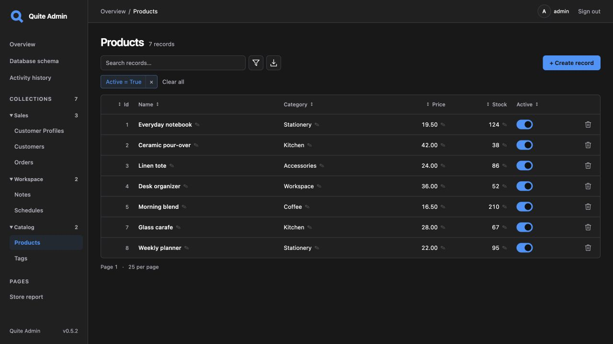
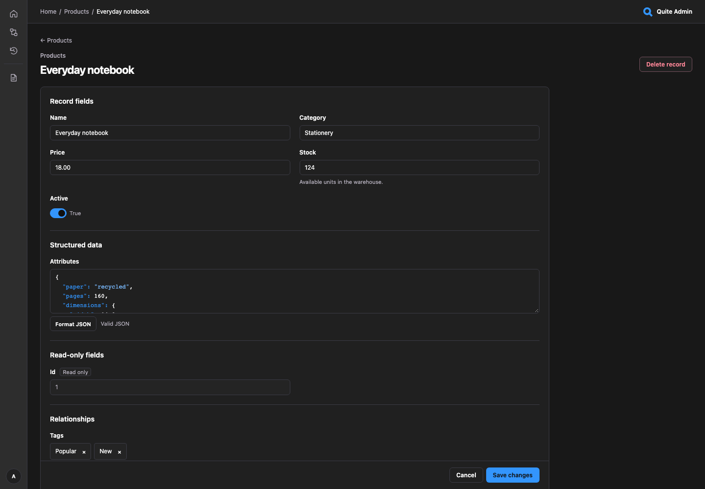
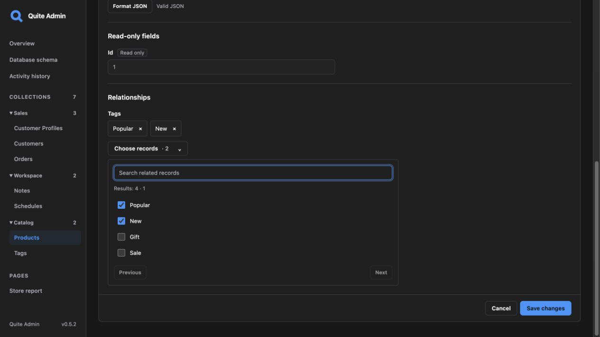
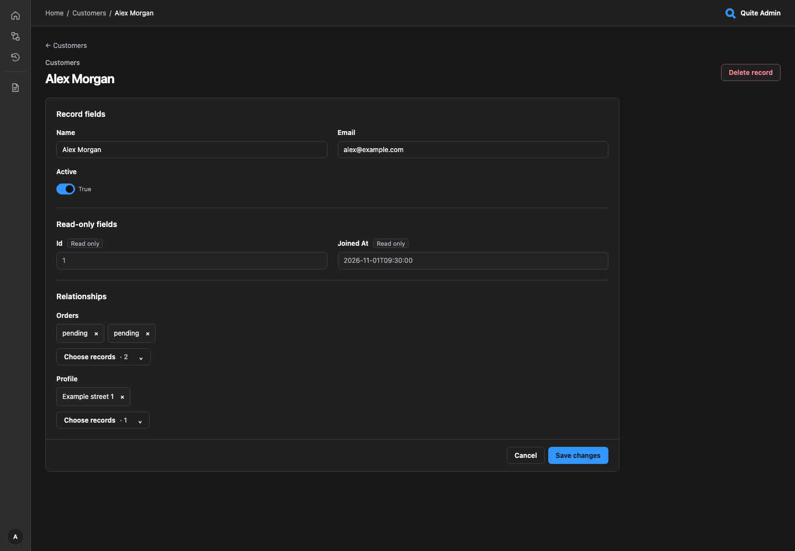

# Подключение к своему приложению

Модели и приложение уже есть? Это руководство подключает их к quite-admin.
Если нужен готовый запускаемый пример, начните с [первой админки](first-app.md).

Нужны CPython **3.11–3.15**, существующее приложение, база и модели.
Установите quite-admin из PyPI в окружение приложения:

```bash
pip install 'quite-admin[sqlalchemy,fastapi]'
# Для Litestar: uv add 'quite-admin[sqlalchemy,litestar]'
```

Для воспроизводимой установки сохраняйте зависимости приложения в lock-файле.
Также поддерживается установка из исходного checkout или архива.

## Существующее FastAPI-приложение

Добавьте код рядом с созданием `app`. Замените импорт на свои существующие
SQLAlchemy/SQLModel base и фабрику сессий:

```python
import os
from quite_admin import Admin, PasswordAuth
from quite_admin.adapters.sqlalchemy import SQLAlchemyAdapter
from myapp.database import Base, SessionFactory

admin = Admin(
    auth=PasswordAuth.single_user('admin', os.environ['QUITE_ADMIN_PASSWORD']),
    secret_key=os.environ['QUITE_ADMIN_SECRET'],
    adapters=[SQLAlchemyAdapter(SessionFactory, base=Base)],
    secure_cookies=False,  # Локальный HTTP; в production с HTTPS используйте True.
)
admin.mount_fastapi(app)
```

В конфигурации приложения задайте `QUITE_ADMIN_PASSWORD` и постоянный случайный
`QUITE_ADMIN_SECRET` длиной не менее 32 байт. Импортируйте модули моделей до startup.
Запустите приложение как обычно и откройте `/admin/`; логин — `admin`, пароль из
настройки. Дополнительные схемы и классы admin-моделей не нужны. Lifespan базы
и миграции остаются под управлением приложения.

## Существующее Litestar-приложение

Используйте тот же `Admin`, заменив вызов mount:

```python
admin.mount_litestar(app)
```

Подключайте до запуска приложения. Для Tortoise выполните инициализацию в lifespan
до обнаружения моделей и выберите `TortoiseAdapter`. Все адаптеры, вложенные пути
и прокси описаны в [подключении](integration.md).

## Любая ORM через её базу

Для обнаружения физических таблиц передайте engine существующей базы:

```python
from quite_admin.adapters.sql import SQLAdapter
adapter = SQLAdapter(engine)
```

Укажите `adapters=[adapter]` в `Admin`. Reflection выполняет правила и триггеры БД;
для Python-хуков и бизнес-правил нужен нативный или сервисный адаптер. Перед
открытием коллекций проверьте [защиту секретных и служебных полей](configuration.md)
и [матрицу СУБД](data-safety.md).

## Интерфейс

[](../assets/screenshots/products.png)

Одна страница содержит поля и редакторы связей. На примере read-only видно ту же
страницу с защищённой датой регистрации.

[](../assets/screenshots/record.png)

[](../assets/screenshots/relationships.png)

[](../assets/screenshots/fields.png)

[В обзоре интерфейса](interface-tour.md) показаны вход, календари и журнал действий.

## Запуск готового примера

```bash
uv sync --locked --python 3.15
QUITE_ADMIN_PASSWORD='local-demo-only' uv run uvicorn examples.fastapi_app:app --reload
# Либо examples.litestar_app:app.
```

Откройте [localhost:8000/admin/](http://localhost:8000/admin/), войдите с
`admin` / `local-demo-only`. Пример создаёт отдельную SQLite-базу; путь задаётся
через `QUITE_ADMIN_DEMO_DB`. Для стабильной Python 3.15 нужен uv 0.13.6+.
Самой библиотеке Node.js не нужен — он используется только при сборке документации.

## Хранилище и развёртывание

При переходе с локальной разработки используйте [руководство по развёртыванию](deployment.md).

Админка инициализирует собственное сервисное хранилище `.quite-admin/state.sqlite3`.
Нужен постоянный доступный для записи каталог. Для контейнеров и реплик настройте
`storage` / `QUITE_ADMIN_STORAGE_URL`. По умолчанию история записывает завершённые
изменения (`history_level="changes"`); `"audit"` и `"all"` включают больше событий,
`history_enabled=False` отключает её. См. [хранилище, резервные копии и уровни записи](storage.md).

При развёртывании с HTTPS сохраняйте `secure_cookies=True`, общий постоянный секрет
для процессов, проверьте коллекции и права. Приложение управляет запуском и остановкой БД.
[Лимиты чтения](configuration.md) позволяют оставить часть пула запросам приложения.
[Сессии](authentication.md) описывают отзыв доступа и cookies,
[интеграция](integration.md) — пути монтирования и префиксы reverse proxy.

## Дальше

Попробуйте [фильтры списков](filters.md), [поиск связанных записей](relationships.md)
и [интерактивную схему БД](database-schema.md). Перед открытием админки настройте
[авторизацию и права](authentication.md), затем адаптируйте [палитру, плотность и шаблоны](styling.md)
под своё приложение.
